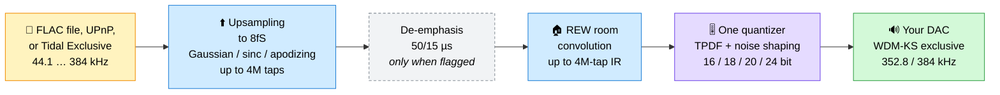

# Audiophile Player

**A headless, no-compromise upsampling player for Windows: every track is rendered in 64-bit float to 8fS (352.8 / 384 kHz), with REW room correction and a single noise-shaped quantizer, sent bit-exact to your DAC over kernel streaming.**


-00b4d8)


No GUI and no volume knob. There is no EQ beyond your REW filter, and no Windows mixer anywhere in the path. All the effort goes into the signal.

> [!TIP]
> **☕ Enjoying the music? Buy me a coffee!**
> Audiophile Player is 100% free and open source — built out of pure obsession with clean sound. If it brings your DAC to life, consider supporting continued development:
>
> [](https://github.com/sponsors/androxylo)
>
> 👉 **[https://github.com/sponsors/androxylo](https://github.com/sponsors/androxylo)**

---

## The signal path



Everything between source and DAC runs in **f64**. The DAC sees exactly **one** rounding operation in the whole chain: the final dithered, noise-shaped quantization. **Upsampling always comes before room correction**, so your REW filter works at the full 8fS rate and covers the whole spectrum.

---

## Two ways to play


| | ⚡ Normal | 💎 Ultimate |
|---|---|---|
| Filter choice | By sample rate: Gaussian long LP (1×) or hi-res LP | Per recording: apodizing, steep sinc, extended-sharp, min/intermediate phase… |
| Detects fake hi-res, pre-ringing (apodizing need), loud & clipped masters | — | ✅ |
| Uses FLAC tags (genre, original year, ReplayGain, pre-emphasis, your overrides) | Peak tags only | ✅ everything |
| Headroom | −3 dB or 0 dB from peak tags | One exact gain per track, measured after the full chain |
| REW impulse tail | Tail below −200 dB is trimmed on very long IRs | Full tail, never truncated |
| Start-up | Instant | First 30 s are rendered before the first sample plays |

👉 **[How Ultimate Mode thinks →](docs/ULTIMATE_MODE.md)**

---

## Quick Start (Windows 10/11 x64)

### Path A — One-line installer (builds from source by default)

Open PowerShell and run:

```powershell
irm https://github.com/androxylo/audiophile_player/releases/latest/download/bootstrap.ps1 | iex
```

- **Builds locally from source** by default (installs Git, Rust, and VS Build Tools via WinGet if missing, compiles `audiophile-player.exe`, creates Start Menu/Desktop shortcuts, and runs `audiophile-player doctor`).
- **Prefer to inspect first or use a verified pre-built binary?** Download `scripts/bootstrap.ps1`, read it, and run `.\bootstrap.ps1` (source build) or `.\bootstrap.ps1 -Binary` (opt-in SHA-256 + GitHub provenance verified release archive).

### Path B — Let a free AI agent install & tune it for you

Clone or point a free coding assistant (**Antigravity CLI** or **VS Code + GitHub Copilot Free**) at this repo — it reads [`AGENTS.md`](AGENTS.md), runs `audiophile-player doctor --json` / `devices --json`, configures your DAC and music folder, and can control playback through the built-in MCP server (`audiophile-player mcp`). See [Getting Started → Path B](docs/GETTING_STARTED.md#path-b--let-a-free-ai-agent-install-and-configure-it) for step-by-step instructions.

---

## Where to go next

| | Page | What you'll find |
|---|---|---|
| 🚀 | **[Getting Started](docs/GETTING_STARTED.md)** | Quick start (source, verified binary, or free AI agent), first play, web page, UPnP, Tidal Exclusive driver, REW config |
| ⌨️ | **[CLI Reference](docs/CLI.md)** | Complete auto-generated command, flag, exit-code, and `config.toml` reference (`audiophile-player help --json`) |
| 💎 | **[Ultimate Mode](docs/ULTIMATE_MODE.md)** | The 30-second look-ahead, the detectors, how a filter is chosen, exact headroom, learn-on-play, per-track overrides |
| 🎛️ | **[Sound Engine](docs/SOUND_ENGINE.md)** | Every filter and noise shaper explained for HQPlayer users, DAC bits, headroom policy, REW convolution, gapless |

---

## At a glance

```mermaid
mindmap
  root((Audiophile<br/>Player))
    Sources
      Local FLAC library
      UPnP / DLNA renderer
      Tidal Desktop (opt-in exclusive ACX driver)
    DSP
      f64 throughout
      8fS only
      ≤ 4M taps
      REW convolution
    Output
      WDM-KS kernel streaming
      Exclusive only
      Releases DAC on pause
    Control
      Tiny local web page
      foobar2000 / BubbleUPnP
      Command line
```



**Status and honest limits**
- 🟢 **Works today:** local FLAC (random or sequential, gapless), UPnP renderer (gapless), **Tidal Desktop Exclusive Mode** via our opt-in Rust ACX virtual driver (zero Windows mixer), normal and ultimate modes, REW convolution, offline library scan, local web page.
- 🟡 **Planned:** WASAPI exclusive output, per-channel delay.
- 🔴 **Not supported, by design:** Windows shared mode, volume control, DSP effects, macOS / Linux playback, DACs without 352.8 / 384 kHz input.
- Reference DAC: **Schiit Gungnir 2** (Unison USB, NOS). Any DAC that accepts 32-bit 352.8 / 384 kHz over a kernel-streaming driver should work.

## License

Copyright (C) 2026 **androxylo**

Audiophile Player is free software: you can redistribute it and/or modify it under the terms of the **GNU General Public License** as published by the Free Software Foundation, either version 3 of the License, or (at your option) any later version ([`GPL-3.0-or-later`](LICENSE)).

This program is distributed in the hope that it will be useful, but **WITHOUT ANY WARRANTY**; without even the implied warranty of MERCHANTABILITY or FITNESS FOR A PARTICULAR PURPOSE. See the [GNU General Public License](LICENSE) for details.

The optional kernel driver (`drivers/ap-exclusive-acx`) includes a GPLv3 Section 7 additional permission for linking with Microsoft WDK/KMDF/ACX static libraries; see [`drivers/ap-exclusive-acx/NOTICE`](drivers/ap-exclusive-acx/NOTICE).

The repository contains no copyrighted music and no proprietary filter coefficients. Shapers named after familiar ones (`ns5`, `lns15`, `pggb-optimal`) are clean-room designs that follow the published *intent* of those shapers. They are not copies.
