# Audiophile Player

**🏠 Home** · [🚀 Quick Start](docs/QUICK_START.md) · [🧭 Getting Started](docs/GETTING_STARTED.md) · [💎 Ultimate Mode](docs/ULTIMATE_MODE.md) · [🎛️ Sound Engine](docs/SOUND_ENGINE.md) · [⌨️ CLI](docs/CLI.md)

**A free, headless upsampling player for Windows. Every track is processed in 64-bit float at 8fS (352.8 / 384 kHz) with long filters, your REW room correction and a single noise-shaped quantizer, then sent to your DAC in WDM-KS exclusive mode.**


-00b4d8)
-7048e8)


It has no GUI and no volume knob. There's no EQ beyond your REW filter, and the Windows mixer is never in the path. All the effort goes into the signal.

**Who it's for:** people who already think in terms of poly-sinc, apodizing and noise shapers (if you've used HQPlayer, you'll feel at home) and want a free, open-source, set-and-forget player for a dedicated Windows PC with a good DAC. You don't need to be a programmer: the installer builds it for you, or a free AI assistant can do the whole setup.

> [!TIP]
> **☕ Enjoying the music? Buy me a coffee!**
> Audiophile Player is 100% free and open source, built out of pure obsession with clean sound. If it brings your DAC to life, please consider supporting continued development:
>
> [](https://github.com/sponsors/androxylo)
>
> 👉 **[https://github.com/sponsors/androxylo](https://github.com/sponsors/androxylo)**

---

## ⏱️ Get started in 3 minutes

Windows 10/11 x64 and a USB DAC. Pick **one** of the three ways in:

| | Way in | You do | Good for |
|---|---|---|---|
| 1️⃣ | **Paste one line** | Open PowerShell, paste the line below, approve the Windows admin prompt(s), wait 10–30 min while it builds | Most people. Builds the newest code on your own PC from source you can read |
| 2️⃣ | **Ask a free AI** | Install a free AI agent (Antigravity CLI or VS Code + Copilot Free), then type *"Install and set up https://github.com/androxylo/audiophile_player on this PC"* | People who'd rather ask than type commands. The AI can also control the player afterwards |
| 3️⃣ | **Download prebuilt** | Run the installer with `-Binary`, or download the zip from [Releases](https://github.com/androxylo/audiophile_player/releases) and check its SHA-256 | No compiler, no admin prompt. The prebuilt version may be older than the newest source |

```powershell
irm https://github.com/androxylo/audiophile_player/releases/latest/download/bootstrap.ps1 | iex
```

Then press the **Audiophile Player** icon on your desktop. 👉 **[Step-by-step Quick Start, including all three ways →](docs/QUICK_START.md)**

---

## 🎚️ The signal path

```mermaid
flowchart LR
    SRC["🎵 FLAC file, UPnP,<br/>or Tidal Exclusive<br/>44.1 … 384 kHz"]:::src
    UP["⬆️ Upsampling<br/>to 8fS<br/>Gaussian / sinc / apodizing<br/>up to 4M taps"]:::dsp
    DE["De-emphasis<br/>50/15 µs<br/><i>only when flagged</i>"]:::opt
    REW["🏠 REW room<br/>convolution<br/>up to 4M-tap IR"]:::dsp
    DS["⬇️ Downsampling<br/>to your DAC's rate<br/><i>only for DACs below 8fS</i>"]:::opt
    Q["🎚️ One quantizer<br/>TPDF + noise shaping<br/>16 / 18 / 20 / 24 bit"]:::q
    DAC["🔊 Your DAC<br/>WDM-KS exclusive<br/>44.1 … 384 kHz"]:::dac

    SRC --> UP --> DE --> REW --> DS --> Q --> DAC

    classDef src fill:#fff3bf,stroke:#f08c00,color:#000
    classDef dsp fill:#d0ebff,stroke:#1c7ed6,color:#000
    classDef opt fill:#f1f3f5,stroke:#868e96,color:#000,stroke-dasharray: 4 3
    classDef q fill:#e5dbff,stroke:#7048e8,color:#000
    classDef dac fill:#d3f9d8,stroke:#2f9e44,color:#000
```



- Everything between the source and the DAC runs in **f64**. The DAC sees exactly **one** rounding step in the whole chain: the final dithered, noise-shaped quantization.
- **Upsampling always comes before room correction**, so your REW filter works at the full 8fS rate and covers the whole spectrum.
- **On a 352.8 / 384 kHz DAC there is no downsampling at all.** On a slower DAC, the whole chain still runs at 8fS. Only the very last stage, right before the quantizer, converts down to the highest rate the DAC accepts. [How that works →](docs/SOUND_ENGINE.md#lower-rate-dacs-below-8fs)

---

## ⚡ Two ways to play

| | ⚡ Normal (default) | 💎 Ultimate (`--ultimate`) |
|---|---|---|
| Filter choice | By sample rate: long Gaussian for 1×, hi-res Gaussian for 2×–4× | Per recording: apodizing, steep sinc, extended-sharp, min/intermediate phase… |
| Detects fake hi-res, pre-ringing, loud & clipped masters | — | ✅ |
| Uses your per-album / per-track filter choices (`my-filters.yaml`) | — | ✅ |
| Headroom | −3 dB or 0 dB, from peak tags | One exact gain per track, measured after the full chain |
| Start-up | Instant | The first 30 s are rendered before the first sample plays |

👉 **[How Ultimate Mode thinks →](docs/ULTIMATE_MODE.md)**

---

## 🧭 Where to go next

| | Page | What you'll find |
|---|---|---|
| 🚀 | **[Quick Start](docs/QUICK_START.md)** | Install (one line, AI agent, or prebuilt), first run, AI/MCP control, updating, uninstalling, troubleshooting |
| 🧭 | **[Getting Started](docs/GETTING_STARTED.md)** | Setup and everyday use: config file, web page, REW room correction, Ultimate mode, library scan, UPnP, Tidal driver |
| 💎 | **[Ultimate Mode](docs/ULTIMATE_MODE.md)** | The 30-second look-ahead, the detectors, how a filter is chosen, exact headroom, `my-filters.yaml` |
| 🎛️ | **[Sound Engine](docs/SOUND_ENGINE.md)** | Every filter and noise shaper explained for HQPlayer users, DAC bits, lower-rate DACs, headroom, REW, gapless |
| 🎧 | **[Filter Preferences](docs/FILTER_PREFERENCES.md)** | Community listening notes mapped to this player's filters |
| ⌨️ | **[CLI Reference](docs/CLI.md)** | Every command, flag, config key and exit code (generated from the code) |

---

## 🚦 Status and honest limits

- 🟢 **Works today:** local FLAC (random or sequential, gapless); UPnP renderer (gapless); **Tidal Desktop Exclusive Mode** through the opt-in ACX virtual driver; normal and ultimate modes; REW convolution; offline library scan and filter database; local web page; DACs from 44.1 to 384 kHz; diagnostics; AI control over stdio MCP.
- 🟡 **Planned:** WASAPI exclusive output, per-channel delay. An HTTP transport for MCP is deferred until someone asks for it.
- 🔴 **Not supported, by design:** Windows shared mode, volume control, DSP effects, macOS / Linux playback.
- 📦 **Prebuilt binaries** come with some release tags only and can lag behind the source. Building from source is the default.
- 🧪 **Reference DAC:** Schiit Gungnir 2 (Unison USB, NOS, 352.8 / 384 kHz). A native 8fS DAC is still the best match. Lower-rate DACs are supported, but they hear the 8fS chain through one extra (very clean) conversion step.
- 🐢 **Ultimate mode is CPU-hungry.** The 4M-tap filters take a while to start on a modest PC. A [library scan](docs/GETTING_STARTED.md#scan-your-library-optional) makes later plays faster and exact from the first second.

## License

Copyright (C) 2026 **androxylo**

Audiophile Player is free software: you can redistribute it and/or modify it under the terms of the **GNU General Public License** as published by the Free Software Foundation, either version 3 of the License, or (at your option) any later version ([`GPL-3.0-or-later`](LICENSE)).

This program is distributed in the hope that it will be useful, but **WITHOUT ANY WARRANTY**; without even the implied warranty of MERCHANTABILITY or FITNESS FOR A PARTICULAR PURPOSE. See the [GNU General Public License](LICENSE) for details.

The optional kernel driver (`drivers/ap-exclusive-acx`) includes a GPLv3 Section 7 additional permission for linking with Microsoft WDK/KMDF/ACX static libraries; see [`drivers/ap-exclusive-acx/NOTICE`](drivers/ap-exclusive-acx/NOTICE).

The repository contains no copyrighted music and no proprietary filter coefficients. Shapers named after familiar ones (`ns5`, `lns15`, `pggb-optimal`) are clean-room designs that follow the published *intent* of those shapers. They are not copies.
