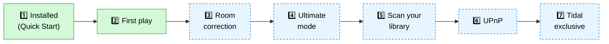
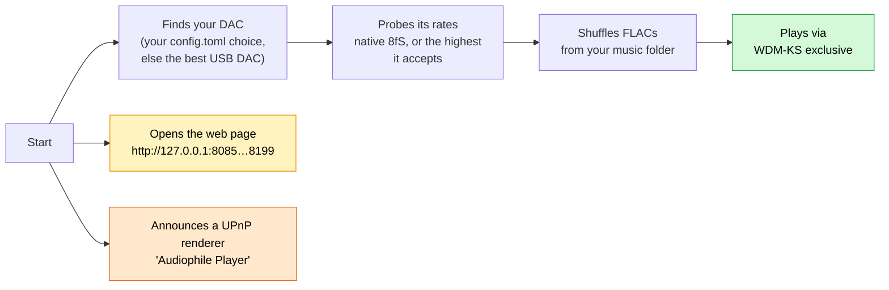
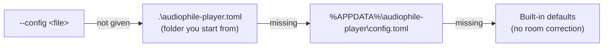
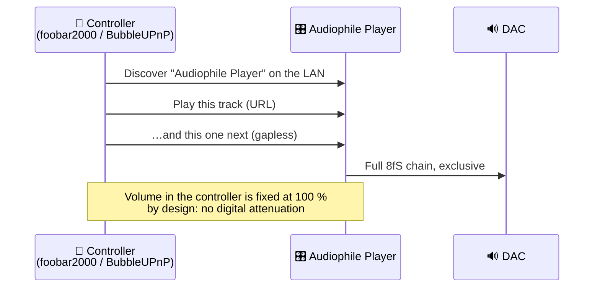
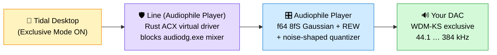

# 🧭 Getting Started: setup and everyday use

[🏠 Home](../README.md) · [🚀 Quick Start](QUICK_START.md) · **🧭 Getting Started** · [💎 Ultimate Mode](ULTIMATE_MODE.md) · [🎛️ Sound Engine](SOUND_ENGINE.md) · [⌨️ CLI](CLI.md)

> **Not installed yet?** Start with the **[Quick Start](QUICK_START.md)**: one-line installer, free AI agent, or verified prebuilt binary, plus first run (`doctor`, `devices`, choosing your DAC and music folder). This page picks up from there.


<sub>Green steps are required. Blue steps are optional.</sub>

> [!NOTE]
> Commands below are written as `audiophile-player …`. If that isn't recognized, see [Quick Start → make the command easy to type](QUICK_START.md#1-make-the-command-easy-to-type-once), or use the full path `%LOCALAPPDATA%\AudiophilePlayer\audiophile-player.exe`.

---

## First play

Double-click **Audiophile Player** (Desktop or Start Menu), or run `audiophile-player` with no options. It then:



The console window shows the DAC it picked, the output rate and format, and one decision line per track. Close the window or press **Ctrl+C** to stop. The DAC is released cleanly.

### The web page

A deliberately tiny page, reachable **only from the same PC**:
- **Folder browser.** Pick a folder or a single file.
- **Play Random**, **Play Sequential**, **Next**.
- **Pause**, which also *releases the DAC* so other apps can use it.
- The current track, its format, and the [Ultimate decision report](ULTIMATE_MODE.md#reading-the-decision-report).
- A log of the last 50 actions.

The page uses the first free port from 8085 to 8199. `audiophile-player status` always shows the real address, and the desktop icon opens it for you (if the player is already running, the icon only reopens the page; it never starts a second player).

---

## Configuration file

The player looks for its settings in this order:



Options on the command line always win over the file. Unknown sections or keys are reported as errors, so typos don't fail silently.

**Edit it safely from the command line.** `config set` validates the value, keeps your comments and saves a `.bak` first:

```powershell
audiophile-player config show                       # values you've set, and the file they come from
audiophile-player config show --effective           # also every default
audiophile-player config set device "Gungnir 2"
audiophile-player config set music_dir "D:\Music"
audiophile-player config set ultimate.enabled true
audiophile-player config unset max_rate             # back to the default
```

Short names work for common keys (`device`, `music_dir`, `filter`, `max_rate`, `dac_bits`, `shaper`, `port`, `ultimate`, `filters`…), and so do the full `section.key` names. Or edit the file by hand, starting from the commented template [`audiophile-player.example.toml`](../audiophile-player.example.toml).

| Section | What it holds |
|---|---|
| `[player]` | DAC, music folder, forced filter, tap limit, output-rate cap, web port, priority |
| `[convolution]` | REW room-correction files |
| `[quantizer]` | DAC bits and noise shaper |
| `[ultimate]` | Ultimate mode and its genre / learn-on-play switches |
| `[filters]` + `[filters.roots]` | Filter-choice mode, database locations, named library roots |
| `[trackdb]` | Legacy Schema-1 database (migrate-only, used by `filters migrate`) |
| `[upnp]` | UPnP renderer name, port, network interface |
| `[capture]` | Tidal exclusive capture watcher |

Every key, its default and its matching command-line flag is in the **[CLI reference](CLI.md)**. The same information is built into the program: `audiophile-player help <option>` (for example `help max-rate`).

### Applying changes while music plays

Settings are read once at start-up, so most changes need a restart. Restarts are gentle by default:

```powershell
audiophile-player restart                      # finish the current track, restart, resume the same folder
audiophile-player restart --ultimate           # same, with extra options for this session
audiophile-player restart --when now --no-conv # don't wait for the track to end
```

`restart` checks new options before stopping anything, so a typo leaves the music playing. **Exception:** per-album and per-track filter choices (`my-filters.yaml`, `filters set`) take effect at the next track with no restart.

---

## Room correction (REW)

1. In REW, export the stereo correction filter as a **WAV, 2 channels**, once at **352,800 Hz** and once at **384,000 Hz** (up to 4M taps). Export at these rates **whatever your DAC's rate is**: room correction always runs at 8fS, before any last-stage downsampling.
2. Point the player at them, in `%APPDATA%\audiophile-player\config.toml`:

```toml
[convolution]
dir = 'C:\Program Files\EqualizerAPO\config'   # newest matching stereo .wav is used
# or name the files explicitly:
# file_352800 = 'D:\REW\room_352k8.wav'
# file_384000 = 'D:\REW\room_384k.wav'
```

   Or from the command line: `audiophile-player config set convolution.dir "D:\REW"`.

3. `audiophile-player restart`. The startup log confirms which file was picked, and why any others were skipped.

To compare with room correction off for one session: `audiophile-player restart --no-conv`. To bypass it without deleting the paths: `config set convolution.enabled false`. How the convolution works: [Sound Engine → REW](SOUND_ENGINE.md#rew-room-correction).

---

## Ultimate mode

```toml
[ultimate]
enabled = true
genre_rules = true      # let GENRE influence the 1× filter choice
learn_on_play = true    # remember exact peaks after a complete play
```

Or `audiophile-player config set ultimate.enabled true`, or just add `--ultimate` for one session. [What it does →](ULTIMATE_MODE.md)

---

## Scan your library (optional)

A one-off, **read-only** pass that analyses every track ahead of time, one album folder per worker, in parallel. Afterwards Ultimate mode starts every track in `cached` state, with exact headroom from the very first play.

```powershell
audiophile-player scan D:\Music --post-chain --report
```

- Leave out the folder to scan all roots in `[filters.roots]` (or your music folder).
- `--post-chain` measures the exact peak through the real filter + REW chain. It's slower and recommended.
- Other useful flags: `--report` (one line per track), `--force` (re-analyse everything), `--jobs N`. All flags: [CLI reference](CLI.md).
- It can run while music plays.

The scan is incremental and resumable. Unchanged files are skipped in microseconds. Metadata-only edits (`GENRE` tags, artwork) reuse the audio analysis without re-decoding. Moved files are recognized by their audio checksum (`STREAMINFO` MD5), and the moves are recorded for `filters relink`. It never modifies FLAC files, and it refuses to cache a file whose audio checksum doesn't match its header.

### Filter database

Two places, kept strictly apart:

| | Where | Who writes it |
|---|---|---|
| 🤖 **Machine analysis** | `%APPDATA%\audiophile-player\filterdb\` (`library.yaml` + one readable YAML per album folder under `analysis\<root>\…`) | The scanner and learn-on-play |
| 👤 **Your choices** | `%APPDATA%\audiophile-player\my-filters.yaml` | **Only you** (by hand or with `filters set`). Re-read at every track change |

Move them with `[filters] dir` / `choices_file` (or `--filterdb-dir` / `--choices-file`).

**Which wins** is set by `--filters` (or `[filters] mode`), and applies in Ultimate mode:

| Mode | Plays |
|---|---|
| `auto` (default) | `mine` if `my-filters.yaml` exists, else `suggested` |
| `mine` | Your choices first, then `AP_*` FLAC tags, then the machine suggestion |
| `suggested` | Pure machine suggestions, ignoring your overrides: instant A/B without editing files |

**Managing choices** with `audiophile-player filters …`:

| Command | What it does |
|---|---|
| `filters show <PATH>` | Your choice vs the suggestion for a file or album folder, with the rule and a plain-English reason |
| `filters set <PATH> <FILTER> [--note "…"]` | Save a choice for a track, an album folder, or a whole library root (validated, comments kept, `.bak` made) |
| `filters diff` | Every track where your choice differs from the suggestion |
| `filters check` | Validate `my-filters.yaml`: unknown filters, missing paths, shadowed rules |
| `filters relink [--apply]` | Preview, then apply, path updates for files you moved |
| `filters migrate [--sidecar-root DIR]` | Import old Schema-1 `trackdb\` entries (and `.ap.yaml` sidecars) without deleting anything |

```powershell
audiophile-player filters set "D:\Music\Jazz\Kind of Blue" gauss-long-lp --note "warmer on this pressing"
audiophile-player filters set "D:\Music" sinc-steep-4m        # default for the whole library root
audiophile-player filters show "D:\Music\Jazz\Kind of Blue"
```

The file format and the full precedence order are in [Ultimate Mode → Your overrides](ULTIMATE_MODE.md#your-overrides-my-filtersyaml).

---

## UPnP: control from foobar2000, BubbleUPnP and others



- Advertised formats are lossless only (FLAC, WAV, L16/L24 PCM…).
- Gapless works with controllers that send "next track" ahead of time.
- Streams always use −3 dB headroom and the long Gaussian filters in place of the 4M class (see [why](ULTIMATE_MODE.md#how-the-filter-is-chosen)).
- Rename it with `config set upnp.friendly_name "Living Room"`; pin it to one network card with `upnp.bind_ip`; turn it off with `config set upnp.enabled false` (or `--no-upnp`).

---

## Tidal Desktop (Exclusive Mode, opt-in)

To feed **vanilla Tidal Desktop** through Audiophile Player's full 8fS `f64` upsampler, REW room convolution, and WDM-KS DAC output, with **zero Windows mixer anywhere in the path**, Audiophile Player includes an optional pure-Rust **ACX 1.1 virtual render driver** (`ap_exclusive_audio.sys`).



> [!IMPORTANT]
> Neither the installer nor the AI/MCP tools ever install this driver. It's a separate, manual step you take on purpose.

### Security implications & trade-offs (opt-in only)

> [!WARNING]
> **Read before installing the virtual driver:**
> - **Windows 11 22H2+ (Build 22621+) x64 only** (requires Microsoft's ACX 1.1 runtime).
> - **Windows Test Mode & UEFI Secure Boot:** Because this is a community open-source project without a paid Microsoft EV/WHQL certificate, loading the driver requires **UEFI Secure Boot OFF** and **Windows Test Mode ON** (`bcdedit /set testsigning on`).
> - **BitLocker / Device Encryption:** Turning off Secure Boot (PCR7) and toggling `testsigning` are BitLocker-validated boot settings. **Back up your 48-digit BitLocker recovery key** ([aka.ms/myrecoverykey](https://aka.ms/myrecoverykey)) before changing BIOS/UEFI settings. `install-driver.ps1` detects BitLocker and automatically suspends it for 2 reboots before editing BCD.
> - **Machine-wide code integrity & anti-cheat/DRM:** While Test Mode is enabled, Windows allows **any** test-signed kernel driver to load, displays a "Test Mode" desktop watermark, and some kernel anti-cheat systems (e.g. Vanguard, FACEIT, EA AC) or DRM paths refuse to run.
> - **Local certificate lifecycle:** `install-driver.ps1` verifies the SHA-256 of the unsigned `.sys`/`.inf`/`.cat` artifacts, copies them to an admin-only directory (`%ProgramData%\AudiophilePlayer\driver`), generates an ephemeral self-signed certificate, adds its **public** cert to `LocalMachine\Root` and `LocalMachine\TrustedPublisher`, signs the staged files, and **immediately deletes the private key**. No third-party private keys or developer certificates are ever distributed.
> - **Clean revert:** Running `uninstall-driver.ps1` as Administrator removes the virtual device, Driver Store package, admin staging folder, and local test certificate, and automatically disables Test Mode if `install-driver.ps1` enabled it (reboot once afterward; you may then re-enable Secure Boot in UEFI with BitLocker suspended/backed up).
> - If you only play local FLACs or UPnP, **you do not need this driver**. Audiophile Player quietly parks its capture watcher when the driver is not installed.

### Install the virtual driver (no WDK needed for release archives)

1. **Get and verify the separate opt-in driver archive** from the [Releases page](https://github.com/androxylo/audiophile_player/releases): download **`audiophile-player-driver-vX.Y.Z-win-x64.zip`** and **`SHA256SUMS`** (the main app zip intentionally contains no kernel `.sys` files). Check its SHA-256 against `SHA256SUMS` and optionally run `gh attestation verify .\audiophile-player-driver-vX.Y.Z-win-x64.zip -R androxylo/audiophile_player`, just like in [Quick Start → A3](QUICK_START.md#a3-prebuilt-binary-no-compiler-no-admin-prompt).
2. **Extract it to an admin-protected folder** (for example `C:\Program Files\AudiophilePlayer-Driver`) so non-admin processes can't tamper with the extracted files, and unblock them (`Get-ChildItem -Recurse | Unblock-File`).
3. Open an **Administrator PowerShell** in the extracted driver folder (`audiophile-player-driver-vX.Y.Z-win-x64\`), or build it from source first with `drivers\ap-exclusive-acx\scripts\build-and-sign.ps1 -FetchWdk` and run from `drivers\ap-exclusive-acx\scripts\`:

```powershell
powershell -ExecutionPolicy RemoteSigned -File .\install-driver.ps1
```

4. If Test Mode is off, the script prints the full security summary, asks you to type `YES` (or pass `-AcceptTestModeRisk`), suspends BitLocker if active, runs `bcdedit /set testsigning on`, and asks you to **reboot once** (exit `3010`). Then run the same command again.
5. On the second run (or immediately if Test Mode is already on), the script verifies the artifact hashes, stages them into `%ProgramData%\AudiophilePlayer\driver`, signs them with a fresh per-machine certificate (deleting the private key right afterwards), registers `ROOT\ApExclusiveAudio`, binds the driver via `pnputil`, and verifies the bound `DriverVersion`.
6. **Restart Tidal Desktop** (if it was already open) so it sees the new output device.
7. In Tidal Desktop → **Sound output**, pick **`Line (Audiophile Player)`**, turn **Use Exclusive Mode ON**, and leave **Force volume OFF**.
8. Start Audiophile Player (the startup log prints `Exclusive capture: READY`) and press Play in Tidal. `audiophile-player doctor` now reports the driver under `capture_driver`.

### How Tidal exclusive capture behaves

- **Preemption:** Starting playback in Tidal automatically preempts local FLAC or UPnP playback. Clicking Pause or switching modes in Audiophile Player releases capture and pauses (clicking **Next** while paused on an active Tidal stream resumes it).
- **Zero-mixer kernel gate & default-device note:** The kernel driver rejects `audiodg.exe` and system/idle callers on `Run`/`SetRenderPacket`, and restricts `\\.\ApExclusiveAudio` to Medium-IL+ callers in the same Windows session as the rendering player. Do **not** set `Line (Audiophile Player)` as your Windows default output device (Windows shared-mode apps will fail cleanly because `audiodg.exe` is blocked).
- **Rate changes & gapless following:** Tidal track changes at the same sample rate flow continuously without flushing the output buffer (Tidal pushes raw PCM over WASAPI Exclusive with no track metadata, so consecutive same-rate tracks appear as one continuous stream). Sample-rate switches (44.1–384 kHz) drain the previous track's full REW tail cleanly and switch the DAC rate automatically with no lost opening samples.
- **Pause latency & clock locking:** Audiophile Player holds a compact ~1.0 s real-time cushion ahead of the DAC (capped at ~3 s total) and slaves the virtual driver's position clock smoothly to your DAC crystal (±500 ppm low-pass). Pausing in Tidal drains the remaining ~0.75–1.0 s cushion plus a 250 ms stop grace before releasing the DAC cleanly.

### Uninstall or disable

```powershell
# Remove the virtual endpoint, Driver Store package, local test cert, and automatically revert
# Test Mode if install-driver.ps1 enabled it (Admin PowerShell; pass -KeepTestSigning to leave Test Mode on):
powershell -ExecutionPolicy RemoteSigned -File .\uninstall-driver.ps1

# Force turning off Windows Test Mode even if you had enabled it manually:
powershell -ExecutionPolicy RemoteSigned -File .\uninstall-driver.ps1 -DisableTestSigning
```

To keep the driver installed while temporarily disabling capture, pass `--no-capture` or run `audiophile-player config set capture.enabled false`. Full driver build details are in [`drivers/ap-exclusive-acx/README.md`](../drivers/ap-exclusive-acx/README.md).

---

## Command-line reference

The complete, generated list of commands, flags, defaults, config keys and exit codes is **[docs/CLI.md](CLI.md)**. The same reference is built into the program, so it always matches your version:

| Command | Shows |
|---|---|
| `audiophile-player help` | Grouped one-line summary of everything |
| `audiophile-player help <option>` | Details for one option: values, default, config key, restart behaviour, examples (e.g. `help max-rate`, `help filters`, `help dac-bits`) |
| `audiophile-player help <command>` | Details for a command (e.g. `help scan`, `help restart`, `help mcp`) |
| `audiophile-player help --json` | The full machine-readable spec (for scripts and AI agents) |

Everyday lifecycle commands (`status`, `stop`, `restart`, `doctor`, `devices`) are summarized in [Quick Start → Everyday commands](QUICK_START.md#everyday-commands-without-ai).

---

## Troubleshooting

Installation and setup problems (installer exit codes, `doctor` items, DAC busy, port, SmartScreen) are covered in [Quick Start → Troubleshooting](QUICK_START.md#troubleshooting). Playback messages:

| Symptom | Likely cause / fix |
|---|---|
| "DAC busy … staying paused" | Another app holds the DAC exclusively. Close it, then press Play |
| "Output error (… unsupported format …)" or exit code `3` | The DAC (or its current driver mode) accepts none of the standard rates. Run `audiophile-player devices`; some DACs have a driver control panel that sets the allowed rates or bit depth |
| Output is 192 kHz (or lower) although you expected 384 | Your DAC tops out there, or `max_rate` is set. Check `devices` and `config show`. This is supported: the last stage converts down |
| `[shaper warn] noise shaper '…' requires 4fS/8fS …; falling back to tpdf` | You forced a shaper (`--shaper ns5` etc.) on a DAC running at 96 kHz or lower. Shaped profiles exist for 176.4 / 192 / 352.8 / 384 kHz only; flat TPDF is used below that |
| Wrong output device | `config set device "<any part of the name>"`, then `restart` |
| Tidal doesn't show `Line (Audiophile Player)` | Restart Tidal Desktop once after running `install-driver.ps1`; check that `Get-PnpDevice -Class MEDIA` shows `Audiophile Player` as `OK` |
| `[capture zero-mixer] Blocked … audiodg.exe` | Normal safety message: Windows or an app tried shared mode (mixer) on `Line (Audiophile Player)` and the kernel rejected it. Turn **Use Exclusive Mode ON** in Tidal |
| `[clip warn] Quantizer clipped N sample(s)` | Rare. With Ultimate learn-on-play, the next play is corrected automatically |
| `[ultimate throughput] REFUSED …` | The PC was too slow for the chosen filter in real time. A lighter **exact** filter was used instead |
| Ultimate mode starts slowly | Expected: the first 30 s are rendered before playback starts. Run a [library scan](#scan-your-library-optional), or use a faster CPU |
| A change in `config.toml` has no effect | Settings are read at start-up: run `audiophile-player restart` |

---

<details>
<summary><b>For developers: repository layout</b></summary>

```text
crates/
  ap-core/            config, headroom, FLAC metadata, track DB, filter DB
  ap-stream-protocol/ shared no_std kernel/user IOCTL ABI for exclusive capture
  ap-source/          FLAC decoding, HTTP streams, exclusive kernel stream capture
  ap-dsp/             upsampling, analysis, REW convolution, last-stage downsampler, quantizer
  ap-output-win/      WDM-KS kernel streaming (Windows)
  ap-upnp/            UPnP / DLNA renderer
  ap-control/         local web page and /api/v1 control API
  ap-cli/             the audiophile-player binary (CLI spec, diagnostics, lifecycle, MCP)
drivers/
  ap-exclusive-acx/   opt-in pure-Rust KMDF 1.31 + ACX 1.1 virtual render driver
scripts/              bootstrap installer, shortcut launcher, release packager
docs/research/        design research and open questions
poc/                  prototypes
tests/                synthetic CC0 test fixtures
```

Build: `cargo build --release --locked`; tests: `cargo test --workspace`. The CLI reference is generated: after changing an option in `crates/ap-cli/src/cli_spec.rs`, run `cargo run --bin audiophile-player -- help --markdown > docs/CLI.md`. AI coding agents: see [`AGENTS.md`](../AGENTS.md). Design background: [REQUIREMENTS.md](../REQUIREMENTS.md) and [docs/research/](research/).

</details>

[← Quick Start](QUICK_START.md) · [🏠 Home](../README.md) · Next: [💎 Ultimate Mode →](ULTIMATE_MODE.md)
