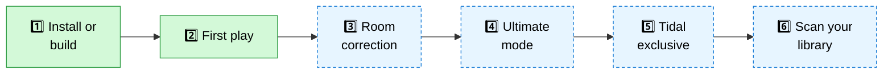
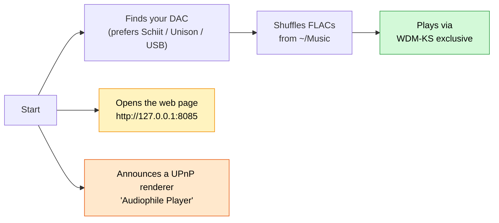
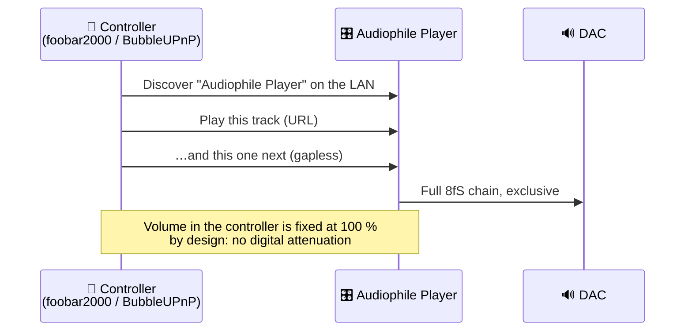
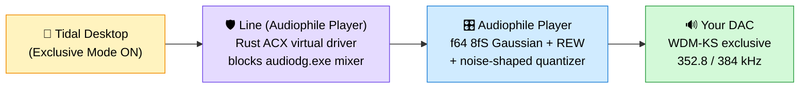
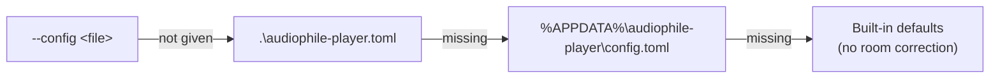

# 🚀 Getting Started

[← Home](../README.md) · [Ultimate Mode](ULTIMATE_MODE.md) · [Sound Engine](SOUND_ENGINE.md) · **Getting Started** · [CLI Reference](CLI.md)


<sub>Green steps are required. Blue steps are optional.</sub>

---

## What you need

| | |
|---|---|
| 💻 **PC** | Windows 10/11, 64-bit. A fast multi-core CPU makes Ultimate mode start sooner |
| 🔊 **DAC** | WDM-KS USB DAC — **32-bit, 352.8 / 384 kHz native preferred** (reference: Schiit Gungnir 2). DACs limited to `192 / 176.4 / 96 / 88.2 / 48 / 44.1 kHz` (32/24/16-bit) are supported automatically via last-stage pure-`f64` downsampling |
| 🎵 **Music** | FLAC files (any rate from 44.1 to 384 kHz), a UPnP controller app, or Tidal Desktop (opt-in driver) |
| 🛠️ **To build from source** | [Rust](https://rustup.rs) (stable) and Git *(not needed if using a pre-built release archive)* |

> The main DSP chain (upsampling, de-emphasis, REW room convolution) **always** runs at locked **8fS** (`352.8 / 384 kHz`) in `f64`. On a 384 kHz DAC there is zero downsampling. On a lower-rate DAC (or when capped with `--max-rate`), a linear-phase Kaiser anti-aliasing downsampler runs strictly at the very last stage right before the single quantizer.

---

## Install or build

### Path A — One-line Windows installer (recommended)

**Default (builds from source — transparent & auditable):**

```powershell
$s = Join-Path $env:TEMP 'audiophile-player-bootstrap.ps1'
irm https://github.com/androxylo/audiophile_player/releases/latest/download/bootstrap.ps1 -OutFile $s
powershell -ExecutionPolicy Bypass -File $s
```

**Inspect first (security-conscious) or use an opt-in verified pre-built binary:**

```powershell
Invoke-WebRequest https://github.com/androxylo/audiophile_player/releases/latest/download/bootstrap.ps1 -OutFile bootstrap.ps1
notepad bootstrap.ps1              # review the script before running
.\bootstrap.ps1                    # builds from source (needs ~5-6 GB free disk for Rust + VS Build Tools)
# or fast opt-in binary (no compiler needed, verified with SHA-256 + optional `gh attestation verify`):
.\bootstrap.ps1 -Binary
```

What `bootstrap.ps1` does:
- Installs missing prerequisites (`Git.Git`, `Rustlang.Rustup`, `Microsoft.VisualStudio.2022.BuildTools`) via WinGet in source mode (or skips compilers completely with `-Binary`).
- Installs into `%LOCALAPPDATA%\AudiophilePlayer` with an `install-receipt.yaml` record, creates Start Menu and Desktop shortcuts (unless `-SkipShortcuts`), and runs `audiophile-player doctor` to verify your DAC and configuration.
- Supports `-WhatIf` (dry run), `-RegisterMcp` (writes an MCP config snippet), `-Prune` (clean old versions), and `-Uninstall` (removes app & shortcuts without ever touching your music or `config.toml`).

### Path B — Let a free AI agent install and configure it

Prefer having an AI assistant guide the install, inspect your DACs (`devices --json`), configure `config.toml`, and manage filters or playback? Both options below have **free tiers** *(last checked 2026-11-26)* and work out of the box with this repository's [`AGENTS.md`](../AGENTS.md) runbook and built-in stdio MCP server (`audiophile-player mcp`):

1. **Antigravity CLI (`agy`)** *(recommended #1 — terminal-native)*: Free tier available, reads `AGENTS.md` / `GEMINI.md` and `.agents/mcp_config.json` automatically.
2. **VS Code + GitHub Copilot Free** *(recommended #2 — familiar GUI)*: Free tier available, reads `AGENTS.md` and `.vscode/mcp.json` automatically.

> [!NOTE]
> **Honest caveats:** Free tiers have monthly/rolling usage quotas, and you should review your chosen provider's privacy/training settings before pasting personal file paths. An AI agent cannot click Windows UAC elevation dialogs for you — if WinGet installs Visual Studio Build Tools, Windows will ask you to approve the prompt.

Paste this prompt into your AI assistant:

> *"Read `AGENTS.md` in `https://github.com/androxylo/audiophile_player` and guide me through installing, configuring, and verifying Audiophile Player on this Windows PC."*

### Manual install (release archive or git clone)

**From a release archive:** unpack `audiophile-player-vX.Y.Z-win-x64.zip` into a folder of your choice, then optionally create Desktop and Start Menu shortcuts:

```powershell
powershell -ExecutionPolicy Bypass -File scripts\install-shortcuts.ps1
```

**Manual build from source** (or apply `.config\configuration.winget` via `winget configure -f .config\configuration.winget --accept-configuration-agreements`):

```powershell
git clone https://github.com/androxylo/audiophile_player.git
cd audiophile_player
cargo build --release --bin audiophile-player
.\target\release\audiophile-player.exe doctor

# Optional: Desktop + Start Menu icon (starts the player and opens the web page)
powershell -ExecutionPolicy Bypass -File scripts\install-shortcuts.ps1
```

The icon is smart: if the player is already running, clicking it only re-opens the web page. It doesn't restart playback. To assemble a complete release archive yourself (including the unsigned opt-in driver), run `powershell -ExecutionPolicy Bypass -File scripts\package-release.ps1` (or add `-WithoutDriver` for an app-only zip).

---

## First play

Double-click **Audiophile Player**, or run `.\target\release\audiophile-player.exe` with no options. It then:



### The web page
A deliberately tiny page, reachable **only from the same PC**:
- **Folder browser.** Pick a folder or a single file.
- **Play Random**, **Play Sequential**, **Next**.
- **Pause**, which also *releases the DAC*, so other apps can use it.
- The current track, its format, and the [Ultimate decision report](ULTIMATE_MODE.md#reading-the-decision-report).
- A log of the last 50 actions.

If port 8085 is busy, the next free port up to 8199 is used.

### UPnP: control from foobar2000, BubbleUPnP and others



- Advertised formats are lossless only (FLAC, WAV, L16/L24 PCM…).
- Gapless works with controllers that send "next track" ahead of time.
- Streams always use −3 dB headroom and the long Gaussian filters in place of the 4M class (see [why](ULTIMATE_MODE.md#how-the-filter-is-chosen)).

---

## Tidal Desktop (Exclusive Mode — opt-in)

To feed **vanilla Tidal Desktop** through Audiophile Player's full 8fS `f64` upsampler, REW room convolution, and WDM-KS DAC output — with **zero Windows mixer anywhere in the path** — Audiophile Player includes an optional pure-Rust **ACX 1.1 virtual render driver** (`ap_exclusive_audio.sys`).



### Security implications & trade-offs (opt-in only)

> [!WARNING]
> **Read before installing the virtual driver:**
> - **Windows 11 22H2+ (Build 22621+) x64 only** (requires Microsoft's ACX 1.1 runtime).
> - **Windows Test Mode & UEFI Secure Boot:** Because this is a community open-source project without a paid Microsoft EV/WHQL certificate, loading the driver requires **UEFI Secure Boot OFF** and **Windows Test Mode ON** (`bcdedit /set testsigning on`).
> - **BitLocker / Device Encryption:** Turning off Secure Boot (PCR7) and toggling `testsigning` are BitLocker-validated boot settings. **Back up your 48-digit BitLocker recovery key** ([aka.ms/myrecoverykey](https://aka.ms/myrecoverykey)) before changing BIOS/UEFI settings. `install-driver.ps1` detects BitLocker and automatically suspends it for 2 reboots before editing BCD.
> - **Machine-wide code integrity & anti-cheat/DRM:** While Test Mode is enabled, Windows allows **any** test-signed kernel driver to load, displays a "Test Mode" desktop watermark, and some kernel anti-cheat systems (e.g. Vanguard, FACEIT, EA AC) or DRM paths refuse to run.
> - **Local certificate lifecycle:** `install-driver.ps1` verifies the SHA-256 of the unsigned `.sys`/`.inf`/`.cat` artifacts, copies them to an admin-only directory (`%ProgramData%\AudiophilePlayer\driver`), generates an ephemeral self-signed certificate, adds its **public** cert to `LocalMachine\Root` and `LocalMachine\TrustedPublisher`, signs the staged files, and **immediately deletes the private key**. No third-party private keys or developer certificates are ever distributed.
> - **Clean revert:** Running `uninstall-driver.ps1` as Administrator removes the virtual device, Driver Store package, admin staging folder, and local test certificate, and automatically disables Test Mode if `install-driver.ps1` enabled it (reboot once afterward; you may then re-enable Secure Boot in UEFI with BitLocker suspended/backed up).
> - If you only play local FLACs or UPnP, **you do not need this driver**. Audiophile Player quietly parks its capture watcher when the driver is not installed.

### Install the virtual driver (no WDK needed for release archives)

1. **Verify the archive:** Compare the `.zip` file's SHA-256 against the published `.zip.sha256` (`Get-FileHash -Algorithm SHA256 audiophile-player-vX.Y.Z-win-x64.zip`).
2. **Extract to an admin-protected folder** (for example `C:\Program Files\AudiophilePlayer`) so non-admin processes cannot tamper with extracted files, and unblock downloaded files (`Get-ChildItem -Recurse | Unblock-File`).
3. Open an **Administrator PowerShell** in `driver\` (from a release zip) — or build first from source with `drivers\ap-exclusive-acx\scripts\build-and-sign.ps1 -FetchWdk` and then run from `drivers\ap-exclusive-acx\scripts\`:

```powershell
powershell -ExecutionPolicy RemoteSigned -File .\install-driver.ps1
```

1. If Test Mode is off, the script prints the full security summary, asks you to type `YES` (or pass `-AcceptTestModeRisk`), suspends BitLocker if active, runs `bcdedit /set testsigning on`, and asks you to **reboot once** (exit `3010`), then run the same command again.
2. On the second run (or immediately if Test Mode is already on), the script verifies artifact SHA-256 hashes, stages them into `%ProgramData%\AudiophilePlayer\driver`, signs ephemerally with a fresh per-machine certificate (deleting the private key right afterward), registers `ROOT\ApExclusiveAudio`, binds the driver via `pnputil`, and verifies the bound `DriverVersion`.
3. **Restart Tidal Desktop** (if it was already open) so it sees the new output device.
4. In Tidal Desktop → **Sound output**, pick **`Line (Audiophile Player)`**, turn **Use Exclusive Mode ON**, and leave **Force volume OFF**.
5. Start Audiophile Player (the startup log prints `Exclusive capture: READY`) and press Play in Tidal.

### How Tidal exclusive capture behaves

- **Preemption:** Starting playback in Tidal automatically preempts local FLAC or UPnP playback; clicking Pause or switching modes in Audiophile Player releases capture and pauses (clicking **Next** while paused on an active Tidal stream resumes it).
- **Zero-mixer kernel gate & default-device note:** The kernel driver rejects `audiodg.exe` and system/idle callers on `Run`/`SetRenderPacket`, and restricts `\\.\ApExclusiveAudio` to Medium-IL+ callers in the same Windows session as the rendering player. Do **not** set `Line (Audiophile Player)` as your Windows default output device (Windows Shared Mode apps will fail cleanly because `audiodg.exe` is blocked).
- **Rate changes & gapless following:** Tidal track changes at the same sample rate flow continuously without flushing Audiophile Player's output buffer (because Tidal pushes raw PCM over WASAPI Exclusive with no track metadata, consecutive same-rate Tidal tracks appear as one continuous stream). Sample-rate switches (44.1–384 kHz) drain the previous track's full REW tail cleanly and switch DAC rate automatically with zero lost opening samples.
- **Pause latency & clock locking:** Audiophile Player holds a compact ~1.0 s real-time cushion ahead of the DAC (capped at ~3 s total) and slaves the virtual driver's hardware position clock smoothly to your DAC crystal (±500 ppm low-pass). Pausing in Tidal drains the remaining ~0.75–1.0 s cushion plus a 250 ms stop grace before releasing the DAC cleanly.

### Uninstall or disable

```powershell
# Remove the virtual endpoint, Driver Store package, local test cert, and automatically revert
# Test Mode if install-driver.ps1 enabled it (Admin PowerShell; pass -KeepTestSigning to leave Test Mode on):
powershell -ExecutionPolicy RemoteSigned -File .\uninstall-driver.ps1

# Force turning off Windows Test Mode even if you had enabled it manually:
powershell -ExecutionPolicy RemoteSigned -File .\uninstall-driver.ps1 -DisableTestSigning
```

To keep the driver installed while temporarily disabling capture in Audiophile Player, pass `--no-capture` or set `enabled = false` under `[capture]` in `config.toml`. Full driver build details are in [`drivers/ap-exclusive-acx/README.md`](../drivers/ap-exclusive-acx/README.md).

---

## Room correction (REW)

1. In REW, export the stereo correction filter as a **WAV, 2 channels**, once at **352,800 Hz** and once at **384,000 Hz** (up to 4M taps).
2. Create the config file `%APPDATA%\audiophile-player\config.toml`. Use [`audiophile-player.example.toml`](../audiophile-player.example.toml) as a template:

```toml
[convolution]
dir = 'C:\Program Files\EqualizerAPO\config'   # newest matching stereo .wav is used
# or name the files explicitly:
# file_352800 = 'D:\REW\room_352k8.wav'
# file_384000 = 'D:\REW\room_384k.wav'
```

The startup log confirms which file was picked, and why any others were skipped. Use `--no-conv` to compare with room correction off.

---

## Ultimate mode

```toml
[ultimate]
enabled = true
genre_rules = true      # let GENRE influence the 1× filter choice
learn_on_play = true    # remember exact peaks after a complete play
```

Or just add `--ultimate` for one session. [What it does →](ULTIMATE_MODE.md)

---

## Scan your library (optional)

A one-off, read-only pass that analyses each track ahead of time (sharded per album folder in parallel). After it, Ultimate mode starts every track in `cached` state, with exact headroom from the very first play.

```powershell
audiophile-player scan D:\Music --post-chain --report
```

Omit the folder argument to scan all roots in `[filters.roots]` / `library.yaml`. Useful flags include `--post-chain` (measures exact peak through the real filter + REW chain — slower, recommended), `--report`, `--force`, `--jobs <N>`, and `--sidecar`. See [CLI Reference → `scan`](CLI.md#scan) for all options.

The scan is incremental and resumable: unchanged files are skipped in microseconds, metadata-only edits (`GENRE` tags, artwork) reuse audio analysis without re-decoding, and moved files are detected automatically by `STREAMINFO.md5` (recording moves for `my-filters.yaml` in `filterdb\relink-report.yaml`). It never modifies FLAC files, and it refuses to cache a file whose audio checksum doesn't match its header.

### Filter Database (Schema 2)
- **Machine-managed analysis:** `%APPDATA%\audiophile-player\filterdb\` (`library.yaml` + one human-readable YAML file per album folder under `analysis\<root>\...`). Override with `[filters] dir = '…'` or `--filterdb-dir`.
- **Your filter choices:** `%APPDATA%\audiophile-player\my-filters.yaml` — owned solely by you, hot-reloaded on track change, never overwritten by playback or scan. Override path with `[filters] choices_file = '…'` or `--choices-file`.
- **A/B mode:** `--filters auto` (default: uses `mine` when `my-filters.yaml` exists, else `suggested`), `--filters mine`, or `--filters suggested` (ignores overrides for instant comparison).
- **CLI management (`audiophile-player filters ...`):**
  - `filters show <PATH>` — show active (`mine`) vs `suggested` filter, rule, and plain-English `why` for a file or album folder
  - `filters diff` — list every track where your choices differ from machine suggestions
  - `filters set <PATH> <FILTER> [--note "..."]` — validate and write a track or folder choice in `my-filters.yaml` (preserving comments + creating `.bak`)
  - `filters check` — validate `my-filters.yaml` against `library.yaml` (unknown filters, missing paths, shadowed rules)
  - `filters relink [--apply]` — preview or apply moved-file path updates from `filterdb\relink-report.yaml`
  - `filters migrate` — non-destructively import legacy Schema-1 `trackdb\` entries and `user:` overrides into Schema 2
- Legacy Schema-1 `[trackdb]` files remain readable as a fallback. See [Your overrides](ULTIMATE_MODE.md#your-overrides-my-filtersyaml--filters).

---

## Configuration file

The player looks for the config file in this order:



Options on the command line always win over the file. Unknown sections or keys are reported as errors, so typos don't fail silently.

| Section | Keys (default) |
|---|---|
| `[player]` | `device`, `music_dir`, `filter` (auto), `max_taps` (4000000), `max_rate` (auto), `port` (auto 8085..8199), `opt` (high) |
| `[convolution]` | `enabled`, `dir`, `file`, `file_352800`, `file_384000` |
| `[quantizer]` | `dac_bits` (24), `shaper` (auto) |
| `[ultimate]` | `enabled` (false), `genre_rules` (true), `learn_on_play` (true) |
| `[filters]` | `mode` (auto), `dir` (%APPDATA%\audiophile-player\filterdb), `choices_file` (%APPDATA%\audiophile-player\my-filters.yaml), `root.<name>` |
| `[filters.roots]` | Named library roots (e.g. `main = 'D:\Music'`) |
| `[trackdb]` | Legacy Schema-1 fallback: `dir` (%APPDATA%\audiophile-player\trackdb), `sidecar` (false) |
| `[upnp]` | `enabled` (true), `friendly_name` ("Audiophile Player"), `port` (auto), `bind_ip` |
| `[capture]` | `enabled` (true) — opt-in exclusive capture watcher (`\\.\ApExclusiveAudio`) |

You can view and edit keys safely (preserving comments + creating `.bak`) from the command line:

```powershell
audiophile-player config show
audiophile-player config set device "Gungnir 2"
audiophile-player config set music_dir "D:\Music"
audiophile-player config set ultimate.enabled true
```

---

## Command-line reference

The complete, auto-generated list of commands, flags, defaults, exit codes, and `config.toml` keys lives in **[`docs/CLI.md`](CLI.md)**.

You can also inspect the same reference directly from the binary:
- `audiophile-player help` — concise overview
- `audiophile-player help --<topic>` — detailed options for a command or topic (e.g. `help --filters`, `help --scan`, `help --mcp`)
- `audiophile-player help --json` — machine-readable CLI schema (`ap.cli_spec/1`)
- `audiophile-player doctor` / `audiophile-player devices` — environment & DAC diagnostics
- `audiophile-player status` / `stop` / `restart` — control a running player instance cleanly

---

## Troubleshooting

| Symptom | Likely cause / fix |
|---|---|
| "DAC busy … staying paused" | Another app holds the DAC exclusively. Close it, then press Play |
| "Output error (… unsupported format …)" | The DAC (or its driver mode) doesn't accept 32-bit 352.8 / 384 kHz |
| Wrong output device | Use `--device gungnir` (any part of the name) |
| Tidal doesn't show `Line (Audiophile Player)` | Restart Tidal Desktop once after running `install-driver.ps1`; verify `Get-PnpDevice -Class MEDIA` shows `Audiophile Player` as `OK` |
| `[capture zero-mixer] Blocked … audiodg.exe` | Normal safety message: Windows or an app tried Shared Mode (mixer) on `Line (Audiophile Player)` and the kernel rejected it. Turn **Use Exclusive Mode ON** in Tidal |
| `[clip warn] Quantizer clipped N sample(s)` | Rare. With Ultimate learn-on-play, the next play is corrected automatically |
| `[ultimate throughput] REFUSED …` | The PC was too slow for the chosen filter in real time. A lighter **exact** filter was used instead |
| Ultimate mode starts slowly | Expected: the first 30 s are rendered before playback starts. Run a [library scan](#scan-your-library-optional), or use a faster CPU |

---

<details>
<summary><b>For developers: repository layout</b></summary>

```text
crates/
  ap-core/            config, headroom, FLAC metadata, track DB
  ap-stream-protocol/ shared no_std kernel/user IOCTL ABI for exclusive capture
  ap-source/          FLAC decoding, HTTP streams, exclusive kernel stream capture
  ap-dsp/             upsampling, analysis, REW convolution, quantizer
  ap-output-win/      WDM-KS kernel streaming (Windows)
  ap-upnp/            UPnP / DLNA renderer
  ap-control/         local web page
  ap-cli/             the audiophile-player binary
drivers/
  ap-exclusive-acx/   opt-in pure-Rust KMDF 1.31 + ACX 1.1 virtual render driver
scripts/              Windows shortcut launcher & release packager
docs/research/        design research and open questions
poc/                  prototypes
tests/                synthetic CC0 test fixtures
```

Requirements and design background: [REQUIREMENTS.md](../REQUIREMENTS.md) and [docs/research/](research/).

</details>

[← Sound Engine](SOUND_ENGINE.md) · [Home](../README.md)
