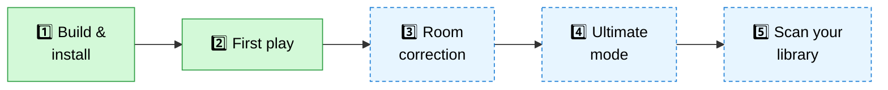
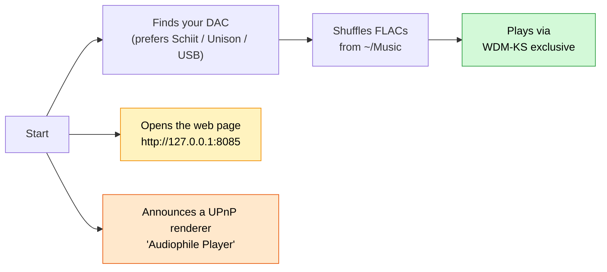
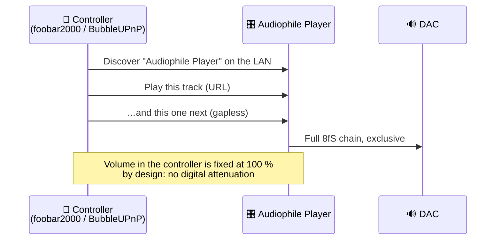
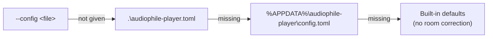

# 🚀 Getting Started

[← Home](../README.md) · [Ultimate Mode](ULTIMATE_MODE.md) · [Sound Engine](SOUND_ENGINE.md) · **Getting Started**


<sub>Green steps are required. Blue steps are optional.</sub>

---

## What you need

| | |
|---|---|
| 💻 **PC** | Windows 10/11, 64-bit. A fast multi-core CPU makes Ultimate mode start sooner |
| 🔊 **DAC** | USB DAC that accepts **32-bit, 352.8 and 384 kHz**. Reference: Schiit Gungnir 2 |
| 🎵 **Music** | FLAC files (any rate from 44.1 to 384 kHz), or a UPnP controller app |
| 🛠️ **To build** | [Rust](https://rustup.rs) (stable) and Git |

> DACs limited to 192 kHz are not supported. The player has no fallback rate, so the DAC will refuse the stream and playback pauses with a message.

---

## Build & install

```powershell
git clone https://github.com/androxylo/audiophile_player.git
cd audiophile_player
cargo build --release --bin audiophile-player

# Optional: Desktop + Start Menu icon (starts the player and opens the web page)
powershell -ExecutionPolicy Bypass -File scripts\install-shortcuts.ps1
```

The icon is smart: if the player is already running, clicking it only re-opens the web page. It doesn't restart playback.

---

## First play

Double-click **Audiophile Player**, or run `.\target\release\audiophile-player.exe` with no options. It then:



### The web page
A deliberately tiny page, reachable **only from the same PC**:
- **Folder browser.** Pick a folder or a single file.
- **Play Random**, **Play Sequential**, **Next**.
- **Pause**, which also *releases the DAC*, so other apps can use it.
- The current track, its format, and the [Ultimate decision report](ULTIMATE_MODE.md#reading-the-decision-report).
- A log of the last 50 actions.

If port 8085 is busy, the next free port up to 8199 is used.

### UPnP: control from foobar2000, BubbleUPnP and others



- Advertised formats are lossless only (FLAC, WAV, L16/L24 PCM…).
- Gapless works with controllers that send "next track" ahead of time.
- Streams always use −3 dB headroom and the long Gaussian filters in place of the 4M class (see [why](ULTIMATE_MODE.md#how-the-filter-is-chosen)).

---

## Room correction (REW)

1. In REW, export the stereo correction filter as a **WAV, 2 channels**, once at **352,800 Hz** and once at **384,000 Hz** (up to 4M taps).
2. Create the config file `%APPDATA%\audiophile-player\config.toml`. Use [`audiophile-player.example.toml`](../audiophile-player.example.toml) as a template:

```toml
[convolution]
dir = 'C:\Program Files\EqualizerAPO\config'   # newest matching stereo .wav is used
# or name the files explicitly:
# file_352800 = 'D:\REW\room_352k8.wav'
# file_384000 = 'D:\REW\room_384k.wav'
```

The startup log confirms which file was picked, and why any others were skipped. Use `--no-conv` to compare with room correction off.

---

## Ultimate mode

```toml
[ultimate]
enabled = true
genre_rules = true      # let GENRE influence the 1× filter choice
learn_on_play = true    # remember exact peaks after a complete play
```

Or just add `--ultimate` for one session. [What it does →](ULTIMATE_MODE.md)

---

## Scan your library (optional)

A one-off, read-only pass that analyses each track ahead of time. After it, Ultimate mode starts every track in `cached` state, with exact headroom from the very first play.

```powershell
audiophile-player scan D:\Music --post-chain --report
```

| Option | Effect |
|---|---|
| `--post-chain` | Also renders each track through the real filter and REW chain to measure its exact peak (slower, recommended) |
| `--report` | One line per track: peak, loudness, detector results, chosen filter |
| `--force` | Re-analyse tracks that are already current |
| `--sidecar` | Write `track.flac.ap.yaml` next to each file instead of the central folder |

The scan uses up to 4 threads and can be resumed. It never modifies audio files, and it refuses to cache a file whose audio checksum doesn't match its header.

### Track DB
- **Central (default):** `%APPDATA%\audiophile-player\trackdb\`. Override with `[trackdb] dir = '…'` or `--trackdb-dir`.
- **Sidecar:** `<track>.flac.ap.yaml` next to the music. Enable with `[trackdb] sidecar = true` or `--trackdb-sidecar`. An existing sidecar is always read.
- Edit the `user:` section to override a track. See [Your overrides](ULTIMATE_MODE.md#your-overrides).

---

## Configuration file

The player looks for the config file in this order:



Options on the command line always win over the file. Unknown sections or keys are reported as errors, so typos don't fail silently.

| Section | Keys (default) |
|---|---|
| `[convolution]` | `enabled`, `dir`, `file`, `file_352800`, `file_384000` |
| `[quantizer]` | `dac_bits` (24), `shaper` (auto) |
| `[ultimate]` | `enabled` (false), `genre_rules` (true), `learn_on_play` (true) |
| `[trackdb]` | `dir` (%APPDATA%\audiophile-player\trackdb), `sidecar` (false) |
| `[upnp]` | `enabled` (true), `friendly_name` ("Audiophile Player"), `port` (auto), `bind_ip` |

---

## Command-line reference

<details>
<summary><b>Playback options</b> (click to expand)</summary>

| Option | Meaning |
|---|---|
| `--music-dir <path>` | Folder to play (default `~/Music`) |
| `--device <name>` | Part of the DAC name, if auto-pick chooses the wrong one |
| `--filter <auto\|name>` | Force an upsampling filter. [List](SOUND_ENGINE.md#upsampling-filters) |
| `--shaper <auto\|name>` | Force a noise shaper. [List](SOUND_ENGINE.md#noise-shaping-and-dac-bits) |
| `--dac-bits <16\|18\|20\|24>` | Dithered output resolution (default 24) |
| `--max-taps <n>` | Upsampling filter length cap (default and maximum 4,000,000) |
| `--conv-dir <path>` / `--conv-file <file>` / `--no-conv` | Room correction source, or off |
| `--ultimate` / `--no-ultimate` | Ultimate mode on / off |
| `--no-genre-rules`, `--no-learn-on-play` | Ultimate mode refinements |
| `--trackdb-dir <path>`, `--trackdb-sidecar` | Track DB location |
| `--no-upnp`, `--upnp-name <n>`, `--upnp-port <p>`, `--upnp-bind <ip>` | UPnP renderer |
| `--port <p>` | Web page port |
| `--opt <normal\|high\|extreme>` | Audio thread and process priority (default high) |
| `--config <file>` | Use this config file |
| `--idle` | Start without audio hardware (testing) |
| `-h`, `--help` | Show help |

</details>

<details>
<summary><b>Scan options</b></summary>

`audiophile-player scan <folder> [--report] [--post-chain] [--force] [--sidecar] [--trackdb-dir <p>] [--config <file>] [--filter <name>] [--conv-dir <p> | --conv-file <file> | --no-conv]`

</details>

---

## Troubleshooting

| Symptom | Likely cause / fix |
|---|---|
| "DAC busy … staying paused" | Another app holds the DAC exclusively. Close it, then press Play |
| "DAC rejected format" | The DAC (or its driver mode) doesn't accept 32-bit 352.8 / 384 kHz |
| Wrong output device | Use `--device gungnir` (any part of the name) |
| `[clip warn] Quantizer clipped N sample(s)` | Rare. With Ultimate learn-on-play, the next play is corrected automatically |
| `[ultimate throughput] REFUSED …` | The PC was too slow for the chosen filter in real time. A lighter **exact** filter was used instead |
| Ultimate mode starts slowly | Expected: the first 30 s are rendered before playback starts. Run a [library scan](#scan-your-library-optional), or use a faster CPU |

---

<details>
<summary><b>For developers: repository layout</b></summary>

```text
crates/
  ap-core/        config, headroom, FLAC metadata, track DB
  ap-source/      FLAC decoding, HTTP streams
  ap-dsp/         upsampling, analysis, REW convolution, quantizer
  ap-output-win/  WDM-KS kernel streaming (Windows)
  ap-upnp/        UPnP / DLNA renderer
  ap-control/     local web page
  ap-cli/         the audiophile-player binary
docs/research/    design research and open questions
poc/              prototypes
tests/            synthetic CC0 test fixtures
```

Requirements and design background: [REQUIREMENTS.md](../REQUIREMENTS.md) and [docs/research/](research/).

</details>

[← Sound Engine](SOUND_ENGINE.md) · [Home](../README.md)
