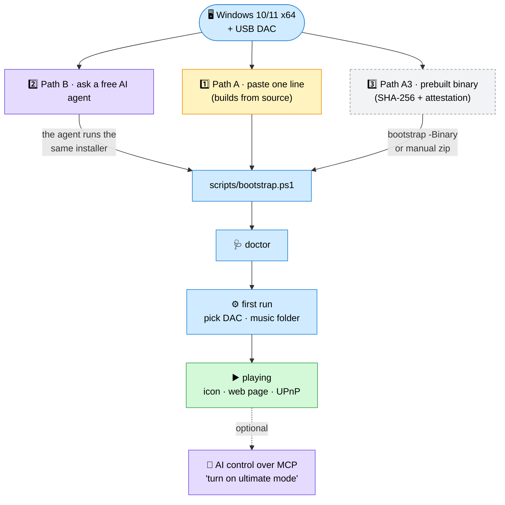
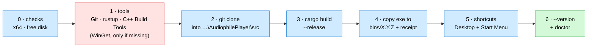
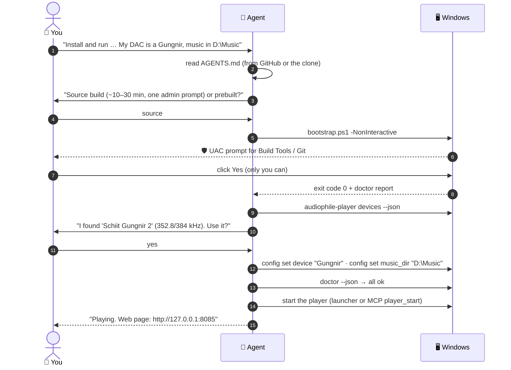
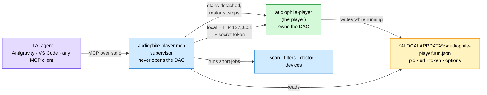
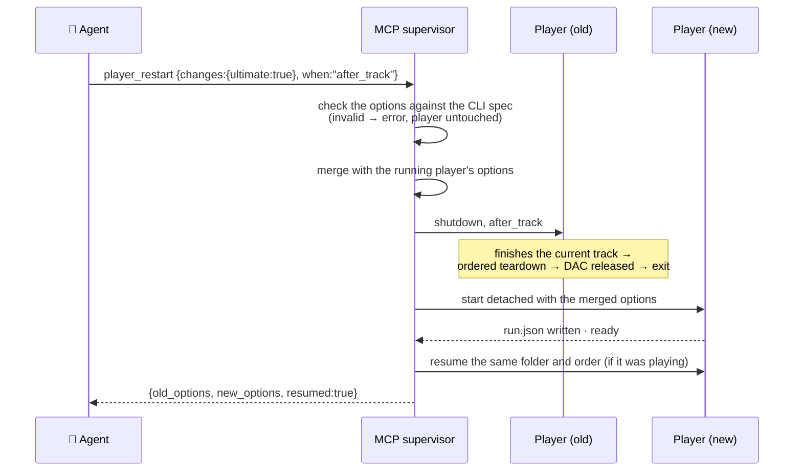

# 🚀 Quick Start

[🏠 Home](../README.md) · **🚀 Quick Start** · [🧭 Getting Started](GETTING_STARTED.md) · [💎 Ultimate Mode](ULTIMATE_MODE.md) · [🎛️ Sound Engine](SOUND_ENGINE.md) · [⌨️ CLI](CLI.md)

This page takes you from a bare Windows PC to music playing, and then shows how to control the player with or without an AI assistant. Pick a path, follow it top to bottom, and skip what you don't need.



**Contents:** [Before you start](#before-you-start) · [Path A: do it yourself](#path-a-do-it-yourself) · [First run](#first-run) · [Path B: let a free AI do it](#path-b-let-a-free-ai-do-it) · [Controlling the player through MCP](#controlling-the-player-through-mcp) · [Everyday commands without AI](#everyday-commands-without-ai) · [Updating](#updating) · [Uninstalling](#uninstalling) · [Troubleshooting](#troubleshooting) · [FAQ](#faq)

---

## Before you start

### Requirements

| | What you need |
|---|---|
| 💻 **PC** | Windows 10 or 11, **64-bit (x64)**. A fast multi-core CPU makes Ultimate mode start sooner |
| 🔊 **DAC** | A USB DAC with a WDM-KS driver. **Best:** native 352.8 / 384 kHz (32-bit). **Also fine:** any DAC that does 44.1 to 192 kHz with 16-, 24- or 32-bit samples. The player converts down at the very last stage ([details](SOUND_ENGINE.md#lower-rate-dacs-below-8fs)) |
| 🎵 **Music** | FLAC files (44.1 to 384 kHz) in a folder. Optional: a UPnP controller app, or Tidal Desktop with the opt-in driver |
| 💾 **Disk** | **Source build:** at least **5 GB free** (the installer checks), mostly for the Visual Studio C++ Build Tools and Rust. **Prebuilt:** about 0.5 GB |
| ⏱️ **Time** | Source build: about **10–30 minutes**, mostly downloads and one compile. Prebuilt: 1–2 minutes |
| 🌐 **Internet** | Needed for the install only. Playback of local files works offline |
| 📦 **WinGet** | Ships with Windows 10/11 as "App Installer". The source build uses it to fetch missing tools |

### What gets installed, and where

| What | Where | Removed by `-Uninstall`? |
|---|---|---|
| The player (`audiophile-player.exe`), its launcher scripts, icon and docs | `%LOCALAPPDATA%\AudiophilePlayer\` (versions under `bin\vX.Y.Z\`) | ✅ |
| Source code and build output (source installs) | `%LOCALAPPDATA%\AudiophilePlayer\src\` | ✅ |
| Install record (`install-receipt.yaml`: kind, version, commit or SHA-256) | `%LOCALAPPDATA%\AudiophilePlayer\` | ✅ |
| Desktop and Start Menu shortcuts "Audiophile Player" | Your Desktop and Start Menu | ✅ |
| Your settings (`config.toml`), filter choices (`my-filters.yaml`), analysis database (`filterdb\`) | `%APPDATA%\audiophile-player\` | ❌ kept |
| Runtime files while the player runs (`run.json`, `mcp-audit.log`) | `%LOCALAPPDATA%\audiophile-player\` | ❌ kept |
| Build tools, **only if missing**: Git, Rust (rustup), Visual Studio 2022 C++ Build Tools | Their normal system locations, via WinGet | ❌ kept (other apps may use them) |

Your music folder is **never written to**, by the installer, the player, the scanner or the AI tools.

> [!NOTE]
> Two similar names: **`AudiophilePlayer`** (under `%LOCALAPPDATA%`) is the program. **`audiophile-player`** (under `%APPDATA%` and `%LOCALAPPDATA%`) holds your settings and runtime files.

### Trust model: why build from source?

Many people won't run an unsigned `.exe` from a stranger, and they're right not to. So by default the installer **never downloads a program from us**:

- 🧾 **Everything comes from sources you already trust:** WinGet (Microsoft) for Git and the Build Tools, rustup (the Rust project) for the compiler, and `git clone` of this public repository.
- 🔍 **You can read every step.** `bootstrap.ps1` is about 300 lines of plain PowerShell. It prints each step before running it, and `-WhatIf` shows the plan without doing anything.
- 🏗️ **The program is compiled on your PC** from the code you can see.
- 📦 **Prebuilt binaries are opt-in** (`-Binary`). They're built by GitHub's CI from a public tag, and checked with SHA-256 plus a GitHub build attestation before anything is unpacked.

### What runs as administrator

| Step | Admin prompt (UAC)? |
|---|---|
| WinGet installing **Visual Studio Build Tools** (and usually **Git**) | **Yes**: Windows asks you to approve. Only you can click it, never an AI agent |
| WinGet installing rustup, cloning, compiling, creating shortcuts | No |
| Prebuilt install (`-Binary`) | **No admin prompt at all** |
| The player itself | No: it runs as your normal user |
| The opt-in Tidal driver | Yes, and it's a separate, manual step ([details](GETTING_STARTED.md#tidal-desktop-exclusive-mode-opt-in)). The installer and the AI tools never touch it |

If all three tools are already installed, a source install shows **no** admin prompt.

---

## Path A: do it yourself

### A1. One line (recommended)

Open **PowerShell** (Start → type `powershell` → Enter; it does **not** need to be "Run as administrator") and paste:

```powershell
irm https://github.com/androxylo/audiophile_player/releases/latest/download/bootstrap.ps1 | iex
```

What happens next:



<sub>Red step: may show a Windows admin prompt. Click **Yes**.</sub>

When it finishes you'll see `[ok] Audiophile Player vX.Y.Z installed in …` followed by the `doctor` report. Continue with [First run](#first-run).

> [!TIP]
> If the `doctor` report lists a problem (no DAC found, music folder missing…), the install itself still succeeded. Those are settings, and [First run](#first-run) fixes them.

### A2. Read it first (for the cautious)

```powershell
cd $HOME\Downloads
irm https://github.com/androxylo/audiophile_player/releases/latest/download/bootstrap.ps1 -OutFile bootstrap.ps1
notepad .\bootstrap.ps1                                                   # read it
powershell -ExecutionPolicy Bypass -File .\bootstrap.ps1 -WhatIf          # show the plan, change nothing
powershell -ExecutionPolicy Bypass -File .\bootstrap.ps1                  # build from source (default)
```

`-ExecutionPolicy Bypass` applies to that one command only. It doesn't change your system policy.

**All installer options** (the real parameters of [`scripts/bootstrap.ps1`](../scripts/bootstrap.ps1)):

| Option | What it does | Default |
|---|---|---|
| `-Dir <path>` | Install folder | `%LOCALAPPDATA%\AudiophilePlayer` |
| `-Ref <name>` | Source mode: git branch or tag to build. `-Binary` mode: release tag to download | `main` (source) / latest release (`-Binary`) |
| `-Binary` | Install the verified prebuilt zip instead of building | off |
| `-WhatIf` | Print the plan and exit without changing anything | off |
| `-SkipShortcuts` | Don't create Desktop / Start Menu shortcuts | off |
| `-RegisterMcp` | Also write `mcp-config.json` into the install folder, ready to paste into an AI agent's global MCP config ([details](#using-mcp-from-any-folder-global-config)) | off |
| `-NonInteractive` | Never prompt (used by AI agents) | off |
| `-Uninstall` | Remove the program and shortcuts ([details](#uninstalling)) | — |
| `-Prune` | Delete old versions under `bin\`, keeping the newest 2 | — |

**Installer exit codes** (useful for scripts and AI agents):

| Code | Meaning |
|---|---|
| `0` | Installed (read the `doctor` output for settings that still need attention) |
| `10` | Prerequisites: not 64-bit Windows, not enough disk space, WinGet missing, or a WinGet install failed |
| `20` | `git clone` / `git fetch` failed (network, proxy, or a wrong `-Ref`) |
| `30` | Compile failed (`cargo build`) |
| `40` | Prebuilt binary: no release found, assets missing, or **SHA-256 / attestation check failed** |
| `50` | Post-install check failed: the installed `audiophile-player.exe` is missing or won't start |

See [Troubleshooting](#troubleshooting) for what to do with each.

### A3. Prebuilt binary (no compiler, no admin prompt)

> [!IMPORTANT]
> Prebuilt binaries are published with **some** release tags only, so the newest prebuilt can be **older than the newest source**. If you want the latest fixes, use A1.

**Option 1: let the installer download and verify it.**

```powershell
& ([scriptblock]::Create((irm https://github.com/androxylo/audiophile_player/releases/latest/download/bootstrap.ps1))) -Binary
```

(or `powershell -ExecutionPolicy Bypass -File .\bootstrap.ps1 -Binary` if you downloaded it as in A2).

The installer then:
1. Asks GitHub for the latest release (or the tag given with `-Ref v0.2.0`).
2. Downloads `audiophile-player-vX.Y.Z-win-x64.zip` and `SHA256SUMS`, and **refuses to continue if the SHA-256 doesn't match** (exit 40).
3. If the GitHub CLI (`gh`) is installed, also verifies the **build attestation**, proving the zip was built by this repository's CI from a public tag. If `gh` isn't installed it says so and relies on the SHA-256 check. Install `gh` with `winget install GitHub.cli` (then `gh auth login`) to get the extra check.
4. Unpacks into `%LOCALAPPDATA%\AudiophilePlayer\bin\vX.Y.Z\`, next to any older version, creates the shortcuts and runs `doctor`.

**Option 2: do it by hand.**

1. Open the [Releases page](https://github.com/androxylo/audiophile_player/releases) and download **`audiophile-player-vX.Y.Z-win-x64.zip`** and **`SHA256SUMS`** from the same release.
2. Check the hash. The two values must be identical:
   ```powershell
   cd $HOME\Downloads
   (Get-FileHash .\audiophile-player-vX.Y.Z-win-x64.zip -Algorithm SHA256).Hash.ToLower()
   Get-Content .\SHA256SUMS
   ```
3. Optional but recommended: verify where it was built:
   ```powershell
   gh attestation verify .\audiophile-player-vX.Y.Z-win-x64.zip -R androxylo/audiophile_player
   ```
   It must report a successful verification for `androxylo/audiophile_player`. Anything else: delete the zip.
4. Unpack it into a folder of your choice (for example `%LOCALAPPDATA%\AudiophilePlayer`), clear the "downloaded from the internet" flag, and create the shortcuts:
   ```powershell
   $d = "$env:LOCALAPPDATA\AudiophilePlayer"
   Expand-Archive .\audiophile-player-vX.Y.Z-win-x64.zip -DestinationPath $d
   # if the zip contains a single top folder, use that folder as $d from here on
   Get-ChildItem $d -Recurse | Unblock-File
   powershell -ExecutionPolicy Bypass -File "$d\scripts\install-shortcuts.ps1"
   ```

### A4. Fully manual (for people who like to see every command)

This is exactly what the installer does, by hand. Run in a normal PowerShell window. Windows will ask for admin approval for the Build Tools (and usually Git).

```powershell
# 1. Tools (skip what you already have)
winget install --exact --id Git.Git --source winget
winget install --exact --id Rustlang.Rustup --source winget
winget install --exact --id Microsoft.VisualStudio.2022.BuildTools --source winget `
  --override "--quiet --wait --norestart --add Microsoft.VisualStudio.Workload.VCTools --includeRecommended"
#    (If you already have Git: after cloning in step 3, this installs the rest from the repo's declarative file:
#     winget configure -f .config\configuration.winget --accept-configuration-agreements)

# 2. Open a NEW PowerShell window so PATH is refreshed, then make sure the MSVC toolchain is the default
rustup default stable-x86_64-pc-windows-msvc

# 3. Get the source and build exactly the audited dependency set
git clone https://github.com/androxylo/audiophile_player.git "$env:LOCALAPPDATA\AudiophilePlayer\src"
cd "$env:LOCALAPPDATA\AudiophilePlayer\src"
cargo build --release --locked --bin audiophile-player

# 4. Check it, and create the Desktop / Start Menu icon
.\target\release\audiophile-player.exe doctor
powershell -ExecutionPolicy Bypass -File scripts\install-shortcuts.ps1
```

`--locked` makes Cargo use the committed `Cargo.lock` as-is, so you build exactly the dependency versions that are in the repository. The launcher finds `target\release\audiophile-player.exe` by itself.

---

## First run

### 1. Make the command easy to type (once)

The installer doesn't change your `PATH`. The program lives at `%LOCALAPPDATA%\AudiophilePlayer\audiophile-player.exe`. To type plain `audiophile-player` from any PowerShell window, add that folder to your user `PATH` once:

```powershell
$d = "$env:LOCALAPPDATA\AudiophilePlayer"
[Environment]::SetEnvironmentVariable('Path', [Environment]::GetEnvironmentVariable('Path','User') + ";$d", 'User')
```

Close and reopen PowerShell. The rest of this page assumes you did this. If you'd rather not, use the full path instead:

```powershell
& "$env:LOCALAPPDATA\AudiophilePlayer\audiophile-player.exe" doctor
```

(A4 users: use `.\target\release\audiophile-player.exe` from the source folder, or add that folder to `PATH` instead.)

### 2. Check the PC: `doctor`

```powershell
audiophile-player doctor
```

`doctor` changes nothing. It checks these items and prints a fix for each problem:

| Item | What it checks | Typical fix |
|---|---|---|
| `os` | 64-bit Windows 10/11 | — |
| `toolchain.git` / `.cargo` / `.rustc` | Build tools (only when run from a source folder) | See [A4](#a4-fully-manual-for-people-who-like-to-see-every-command) |
| `config` | `config.toml` exists and is valid | `audiophile-player config show` to see what's wrong |
| `music_dir` | Your music folder exists and contains `.flac` files | `audiophile-player config set music_dir "D:\Music"` |
| `dac` | A usable DAC is found, and which rates it accepts | `audiophile-player devices`, then `config set device "…"` |
| `http_port` | A free local port for the web page (8085–8199) | `config set port 8090` |
| `capture_driver` | Whether the opt-in Tidal driver is installed (report only) | Nothing, unless you want Tidal ([details](GETTING_STARTED.md#tidal-desktop-exclusive-mode-opt-in)) |

### 3. Choose your DAC: `devices`

Turn the DAC on, connect it, and close any other app that might be using it. Then:

```powershell
audiophile-player devices
```

It lists every audio output Windows offers over kernel streaming, and probes which rates each one accepts:

- **8fS-capable** (352.8 and 384 kHz both supported): the ideal case, no downsampling.
- **Lower-rate** (for example "max 44.1k = 176400 Hz, 48k = 192000 Hz, Int24In32"): fully supported, through the last-stage downsampler.
- **busy**: another program has the DAC in exclusive mode. Close it and run `devices` again.

The player picks the best USB DAC by itself, but it's good to pin your choice. Any unique part of the name works:

```powershell
audiophile-player config set device "Gungnir"
```

### 4. Tell it where your music is

```powershell
audiophile-player config set music_dir "D:\Music"
```

The default is your Windows `Music` folder. Subfolders are fine: the web page lets you browse them.

### 5. Optional settings worth knowing on day one

```powershell
audiophile-player config set ultimate.enabled true   # per-recording filter choice (see Ultimate Mode)
audiophile-player config set dac_bits 16             # only if your converter truly resolves 16 bits (some R-2R)
audiophile-player config set max_rate 192000         # cap the output rate by hand (normally automatic)
audiophile-player config show                         # see what's set, and where each value comes from
```

`config set` checks the value, keeps the comments in your file, and saves a `.bak` copy first. The file is `%APPDATA%\audiophile-player\config.toml`. You can also edit it by hand ([template](../audiophile-player.example.toml)). Every key is listed in the [CLI reference](CLI.md). Room correction is set up in [Getting Started → Room correction](GETTING_STARTED.md#room-correction-rew).

### 6. Start it

- **Double-click the "Audiophile Player" icon** on the Desktop or in the Start Menu. It starts the player in a console window and opens the web page in your browser. If the player is already running, the icon just reopens the web page.
- Or from PowerShell: `audiophile-player` (no arguments). Add options for one session only, for example `audiophile-player --ultimate`.

Music starts in random order from your music folder. To stop: close the console window, press **Ctrl+C** in it, or run `audiophile-player stop`. The DAC is released cleanly either way.

### 7. The web page

```powershell
audiophile-player status     # shows "Web UI: http://127.0.0.1:<port>"
```

It's a deliberately tiny page, reachable **only from the same PC**: folder browser, Play Random / Play Sequential / Next, Pause (which releases the DAC), the current track and format, the [Ultimate decision report](ULTIMATE_MODE.md#reading-the-decision-report), and the last actions. More in [Getting Started](GETTING_STARTED.md#the-web-page).

### 8. Shortcuts later

If you skipped them (`-SkipShortcuts`) or they went missing:

```powershell
powershell -ExecutionPolicy Bypass -File "$env:LOCALAPPDATA\AudiophilePlayer\scripts\install-shortcuts.ps1"
```

🎉 **That's it.** Next: [room correction, Ultimate mode, library scan and UPnP →](GETTING_STARTED.md)

---

## Path B: let a free AI do it

An AI agent can do all of Path A and First run for you, and then keep helping: change modes, scan the library, set filters per album. It doesn't improvise: it reads this repository's [`AGENTS.md`](../AGENTS.md) runbook, runs the **same** `bootstrap.ps1`, and reads the machine-readable output of `doctor --json` and `devices --json` to fix problems.

> [!NOTE]
> **Recommended free agents** *(last checked 2026-11-26)*
> 1. **Antigravity CLI** (`agy`, Google): free with a personal Google account. Runs in PowerShell.
> 2. **VS Code + GitHub Copilot Free** (agent mode): free with a GitHub account. A familiar window instead of a terminal.
>
> **Any agent that reads `AGENTS.md` works.** Gemini CLI no longer has a free tier: Google moved free individual use to Antigravity CLI on 18 June 2026.

### B1. Install an agent

<details open>
<summary><b>Option 1: Antigravity CLI (recommended)</b></summary>

1. Open PowerShell and install it with the line from its official site:
   ```powershell
   irm https://antigravity.google/cli/install.ps1 | iex
   ```
2. Open a new PowerShell window. On the first `agy` run, sign in with your personal Google account.

- **Free tier:** a weekly quota whose size Google doesn't publish. The list of free models gets shorter on **30 Nov 2026**. The install needs very little AI, so a small model is enough.
- **Reads** `AGENTS.md`, and **auto-loads** the workspace MCP config `.agents/mcp_config.json` that this repository ships.
- **Use `--mode=auto`:** it runs safe commands (builds, checks) on its own inside a sandbox, and still asks you before risky steps.

> [!CAUTION]
> Never start it with `--dangerously-skip-permissions`. `--mode=auto` is all this install needs.

</details>

<details>
<summary><b>Option 2: VS Code + GitHub Copilot Free</b></summary>

1. Install VS Code: `winget install Microsoft.VisualStudioCode`.
2. Open VS Code, sign in to GitHub, and enable **GitHub Copilot Free** when offered.
3. Open the Chat view and switch the mode selector to **Agent**.

- **Free tier:** a limited number of agent requests per month.
- **Reads** `AGENTS.md`. MCP servers are supported on the Free plan. This repository ships `.vscode/mcp.json`, so the player's MCP server is pre-configured when you open the repository folder.
- It asks before running each terminal command. Read the command, then click **Continue** (or **Allow**).

</details>

### B2. Open a folder and ask

**Antigravity CLI:**

```powershell
mkdir $HOME\audiophile-setup; cd $HOME\audiophile-setup
agy --mode=auto
```

**VS Code:** File → Open Folder → create and pick an empty folder such as `audiophile-setup`, then open the Chat view in **Agent** mode.

Then type one of these prompts (edit the parts in *italics* for your setup):

> **Install:** "Install and run https://github.com/androxylo/audiophile_player on this PC. Follow its AGENTS.md. Build from source. My DAC is a *Schiit Gungnir* and my music is in *D:\Music*."

> **Prebuilt instead:** "Install https://github.com/androxylo/audiophile_player using the verified prebuilt binary (bootstrap.ps1 -Binary), following its AGENTS.md. My music is in *D:\Music*."

> **Something's wrong:** "Audiophile Player is installed in %LOCALAPPDATA%\AudiophilePlayer. Run `doctor --json` and `devices --json`, explain what's wrong in plain words, and fix only what they report."

> **Room correction:** "Set up REW room correction for Audiophile Player. My exported 352.8 and 384 kHz stereo WAV files are in *D:\REW*."

### B3. What the agent will do, step by step



If the installer returns a non-zero [exit code](#a2-read-it-first-for-the-cautious), the agent reads `doctor --json` and fixes only the reported items. On exit code **40** (verification failed) it must stop and tell you. It must never bypass a failed checksum.

### B4. What you must approve

| You'll be asked about | Why | Say yes? |
|---|---|---|
| Running `bootstrap.ps1` / `winget install …` | Installs the build tools and the player | ✅ if you want the install |
| 🛡️ The **Windows UAC prompt** | Build Tools (and usually Git) install machine-wide | ✅ **you** must click it; the agent can't |
| `config set …` commands | Writes your DAC / music folder into `config.toml` | ✅ check the name and path are right |
| Anything about the **Tidal driver**, Test Mode, BitLocker or Secure Boot | Never needed for setup; `AGENTS.md` forbids it unless you ask | ❌ unless you asked for Tidal and read [the trade-offs](GETTING_STARTED.md#security-implications--trade-offs-opt-in-only) |
| Writing, renaming or tagging files in your **music folder** | Never needed | ❌ always refuse |

### B5. Privacy

- Free AI tiers **may use your prompts and the files the agent reads to train models.** This project is public and GPL, so that's fine for the code.
- But the agent will also see **your folder names, your music folder layout and your device names** (for example from `devices` and `doctor`). Don't use an AI agent if that bothers you: Path A gives you the same result.
- Check your provider's privacy settings. Some let you opt out of training.

### B6. Troubleshooting the AI path

| Symptom | What to do |
|---|---|
| "Quota exceeded" / "rate limit" | Free quotas reset (weekly for Antigravity, monthly for Copilot Free). Wait, or finish by hand: the agent has probably already run `bootstrap.ps1`. Continue at [First run](#first-run) |
| The model is "not available" / a smaller model is used | Free model lists change (Antigravity's shrinks on 30 Nov 2026). The happy path is simple enough for small models; just retry |
| The agent improvises (installs Rust another way, edits files in the repo) | Stop it and say: "Follow AGENTS.md exactly. Only run scripts\bootstrap.ps1." |
| The agent waits forever during the install | Look for a **UAC prompt** behind other windows (it often blinks in the taskbar) and approve it |
| The agent can't find `git` right after installing it | It needs a fresh shell. Ask it to restart its terminal, or reopen the agent in the same folder |
| VS Code doesn't show the `audiophile-player` MCP tools | Open the **installed source folder** (see [below](#opening-the-agent-in-the-installed-folder-zero-setup)), trust it, and start the server from the MCP view or the "Start" link in `.vscode/mcp.json` |

---

## Controlling the player through MCP

Once installed, an AI agent can **operate** the player for you through MCP (Model Context Protocol). The player ships its own MCP server: `audiophile-player mcp`.

### How it works



- The MCP server is a **thin supervisor**. It never plays audio and never opens the DAC. The agent starts it when the agent starts.
- **The player is a separate process that outlives the agent.** Closing the AI never stops the music, and a new AI session finds the running player through `run.json`. That includes a player you started from the desktop icon.
- Talking to the player uses a random secret token stored in `run.json`, readable only by your Windows user. The player only listens on `127.0.0.1`.
- **Only stdio is supported:** no network port, nothing to firewall.

### Mode changes mean a restart, after the current track

The player reads its settings once at start-up, which is the right model for something that owns the DAC exclusively. So **changing the mode, filter policy, device, room correction and so on means a restart**. By default the restart waits **until the current track ends**, so no song is cut. Ask for "now" if you want it immediately.



Two exceptions need **no** restart:
- **Per-album / per-track filter choices** (`filters_set`, `my-filters.yaml`) are picked up at the next track.
- **Play / pause / next / play a file** act on the running player directly.

`config_set` saves a setting **permanently** in `config.toml`; it takes effect at the next restart, and the tool suggests one. `player_restart {changes: …}` applies options to the **running session**, and they're carried over across later restarts of that session. Ask the agent to do both if you want a change to stick and apply now.

### MCP tools

| Tool | What it does | Restart? |
|---|---|---|
| `player_status` | Running or not, PID, web page URL, mode, effective options, current track, DAC claimed or released | — |
| `player_start` | Start the player in the background with the given options (fails if it's already running) | starts |
| `player_stop` | Stop gracefully and release the DAC (`when`: `now` default, or `after_track`) | stops |
| `player_restart` | Restart with changed options (`when`: `after_track` default, or `now`) | **yes** |
| `play` | Play a folder under your music root, `random` or `sequential` | — |
| `play_file` | Play one FLAC file inside your music root | — |
| `pause` / `resume` / `next` | Pause (releases the DAC), resume, skip | — |
| `options_list` | List all options, optionally by group (output, dsp, ultimate, library, network, capture, general) | — |
| `option_describe` | Full help for one option or command (same text as `help <option>`) | — |
| `config_get` | Read effective settings and where each value comes from | — |
| `config_set` | Validate and save one `config.toml` key (comments kept, `.bak` made) | at next restart |
| `scan_start` | Start a read-only background library scan; returns a job id | — |
| `scan_progress` / `scan_cancel` | Check or cancel a scan job | — |
| `filters_show` | Your choice vs the machine suggestion for a file or album, with the reason | — |
| `filters_set` | Save a per-album or per-track filter choice in `my-filters.yaml` | next track |
| `filters_diff` | List every track where your choice differs from the suggestion | — |
| `filters_check` | Validate `my-filters.yaml` | — |
| `doctor` / `devices_list` | The same diagnostics as the CLI commands | — |
| `logs_tail` | The player's most recent actions | — |

The server also offers read-only **resources** (`ap://cli/spec`, `ap://status`, `ap://docs/quick-start`, `ap://docs/getting-started`, `ap://docs/ultimate-mode`, `ap://docs/sound-engine`) and three **prompts** that some clients show as shortcuts: `ap-setup`, `ap-ultimate-on`, `ap-scan-library`.

**Safety limits.** The MCP tools **cannot** change the headroom policy, write into your music library, run arbitrary shell commands, or touch the Tidal driver, Test Mode, BitLocker or certificates. `config_set` accepts only known keys. Every action that changes something is logged with a timestamp in `%LOCALAPPDATA%\audiophile-player\mcp-audit.log`.

### Example conversations

> **You:** Turn on ultimate mode.
>
> **Agent:** *(`config_set` `ultimate.enabled` = `true`, then `player_restart` with `when: after_track`)*
> Done. Ultimate mode is saved in your config. The player will restart when the current track ends, so this song won't be cut. The next track starts with a 30-second look-ahead.

> **You:** Scan my library.
>
> **Agent:** *(`config_get` `player.music_dir` → `D:\Music`; `scan_start` with `post_chain: true`; later `scan_progress`)*
> Scanning D:\Music in the background (read-only, job `scan-1`). Playback continues. I'll check progress whenever you ask. After the scan, Ultimate mode starts every track with exact headroom.

> **You:** Use apodizing for this album.
>
> **Agent:** *(`player_status` → current track `D:\Music\Jazz\Some Album\03.flac`; `filters_set` path `D:\Music\Jazz\Some Album`, filter `gauss-apod-4m`, note "requested by user")*
> Saved in my-filters.yaml for the whole album. It applies from the next track, no restart needed. Note: your own filter choices are used in Ultimate mode, which is on.

> **You:** What's playing?
>
> **Agent:** *(`player_status`)*
> "03 – Track Name" from Some Album, 44.1 kHz / 24-bit, upsampled with `gauss-apod-4m` (your folder choice; the machine suggested `sinc-steep-4m`). Output: Schiit Gungnir 2 at 352.8 kHz.

> **You:** Stop.
>
> **Agent:** *(`player_stop`, `when: now`)*
> Stopped, and the DAC is released. Say "start the player" when you want it back.

You can also say *"stop after this track"* (`player_stop` with `after_track`) or *"restart now with room correction off"* (`player_restart` with `{no_conv: true}` and `when: now`).

### Opening the agent in the installed folder (zero setup)

A **source install** leaves a full copy of the repository in `%LOCALAPPDATA%\AudiophilePlayer\src`, with the built program in `target\release\` and both MCP configs already in place. Start your agent there and the tools are available immediately:

```powershell
cd "$env:LOCALAPPDATA\AudiophilePlayer\src"
agy --mode=auto
```

In VS Code: **File → Open Folder** → `%LOCALAPPDATA%\AudiophilePlayer\src`, trust the folder, and start the `audiophile-player` server when VS Code offers it (or from the MCP servers view).

These are the files the repository ships:

```jsonc
// .agents/mcp_config.json   (Antigravity CLI, loaded automatically for this folder)
{ "mcpServers": { "audiophile-player": {
    "command": "target/release/audiophile-player.exe", "args": ["mcp"] } } }
```

```jsonc
// .vscode/mcp.json   (VS Code + Copilot)
{ "servers": { "audiophile-player": {
    "type": "stdio", "command": "${workspaceFolder}/target/release/audiophile-player.exe", "args": ["mcp"] } } }
```

### Using MCP from any folder (global config)

To control the player from any folder, or after a **prebuilt** install (which has no `src` folder), register the server in your agent's **user-level** (global) MCP config. Point it at the stable copy of the program, `%LOCALAPPDATA%\AudiophilePlayer\audiophile-player.exe`, written out in full (replace `<you>` with your Windows user name):

**Antigravity CLI:** add this to your user-level `mcp_config.json` (see Antigravity's MCP documentation for its location on your PC):

```json
{
  "mcpServers": {
    "audiophile-player": {
      "command": "C:\\Users\\<you>\\AppData\\Local\\AudiophilePlayer\\audiophile-player.exe",
      "args": ["mcp"]
    }
  }
}
```

**VS Code:** Command Palette (Ctrl+Shift+P) → **MCP: Open User Configuration**, and add:

```json
{
  "servers": {
    "audiophile-player": {
      "type": "stdio",
      "command": "C:\\Users\\<you>\\AppData\\Local\\AudiophilePlayer\\audiophile-player.exe",
      "args": ["mcp"]
    }
  }
}
```

Shortcut: running the installer with **`-RegisterMcp`** writes a ready-made `mcp-config.json` (Antigravity format) into `%LOCALAPPDATA%\AudiophilePlayer\`. It points at the versioned `bin\vX.Y.Z\` copy, so after an update that changes the version, either re-run with `-RegisterMcp` or use the stable path shown above.

Any other MCP client works the same way: a stdio server with command `audiophile-player.exe` and the single argument `mcp`.

---

## Everyday commands without AI

| I want to… | Command |
|---|---|
| Start playing | Double-click the icon, or `audiophile-player` |
| See what's playing, the URL, the mode | `audiophile-player status` |
| Stop now and release the DAC | `audiophile-player stop` |
| Stop when this track ends | `audiophile-player stop --when after-track` |
| Apply a saved config change | `audiophile-player restart` (waits for the current track) |
| Try options for this session | `audiophile-player restart --ultimate --filters mine` |
| Restart immediately | `audiophile-player restart --when now` |
| Check what's wrong | `audiophile-player doctor` |
| List DACs and their rates | `audiophile-player devices` |
| See or change settings | `audiophile-player config show` · `config set <key> <value>` · `config unset <key>` |
| Learn about any option | `audiophile-player help` · `help <option>` (e.g. `help max-rate`, `help filters`) · `help <command>` (e.g. `help restart`) |
| Get everything as JSON | add `--json` to `status`, `doctor`, `devices`, `config show`, `stop`, `restart`; `help --json` for the full spec |

`restart` checks the new options **before** it stops anything: a typo gives you an error and the music keeps playing. It merges your new options onto the ones the player is running with, waits for the track to end (unless `--when now`), starts the new instance in the background and resumes the same folder. The full list of options is in the [CLI reference](CLI.md).

**Exit codes** of the player's commands: `0` ok · `1` runtime error · `2` wrong arguments · `3` DAC problem (missing, busy, no usable rate) · `4` config error · `5` already running (on start) / not running (`status`, `stop`, `restart`).

---

## Updating

| You installed with | To update |
|---|---|
| A1 / A2 (source) | Run the same one-liner (or `bootstrap.ps1`) again. It fetches the newest source into `src\`, rebuilds, and installs it. Settings are kept |
| A3 (prebuilt via installer) | Run with `-Binary` again. The new version goes into its own `bin\vX.Y.Z\` folder **next to** the old one, and the shortcuts switch to it. Old versions stay until you run `-Prune` (keeps the newest 2) |
| A3 (manual zip) | Verify and unpack the new zip as before, over the old folder or into a new one |
| A4 (manual) | `git pull`, then `cargo build --release --locked --bin audiophile-player` |
| An AI agent | Ask: "Update Audiophile Player following AGENTS.md." |

Stop the player first (`audiophile-player stop`) so its files aren't in use. Your `config.toml`, `my-filters.yaml` and scan database are never touched by updates. `audiophile-player --version` shows what you're running.

---

## Uninstalling

```powershell
& ([scriptblock]::Create((irm https://github.com/androxylo/audiophile_player/releases/latest/download/bootstrap.ps1))) -Uninstall
# or, with a downloaded copy:  powershell -ExecutionPolicy Bypass -File .\bootstrap.ps1 -Uninstall
```

Add `-WhatIf` to preview, and `-Dir <path>` if you installed somewhere else. It stops the player, removes the Desktop and Start Menu shortcuts, and deletes the install folder (`%LOCALAPPDATA%\AudiophilePlayer`, including `src\`).

**Left behind on purpose** (delete by hand if you want them gone):

| What | Where |
|---|---|
| Your settings, filter choices, scan database | `%APPDATA%\audiophile-player\` |
| Runtime files and the MCP audit log | `%LOCALAPPDATA%\audiophile-player\` |
| Git, Rust, VS Build Tools (if the installer added them) | **Settings → Apps → Installed apps**, or `winget uninstall --id Git.Git` / `Rustlang.Rustup` / `Microsoft.VisualStudio.2022.BuildTools` |
| Rust's download cache | `%USERPROFILE%\.cargo` (removed by uninstalling rustup) |
| MCP entries you added to an AI agent's global config | Your agent's MCP config file |
| The `PATH` entry from [First run](#1-make-the-command-easy-to-type-once) | Settings → System → About → Advanced system settings → Environment Variables |
| The Tidal driver, if you installed it | Run `uninstall-driver.ps1` **before** uninstalling ([details](GETTING_STARTED.md#uninstall-or-disable)) |

Your music folder was never touched.

---

## Troubleshooting

| Symptom | Cause and fix |
|---|---|
| Installer exit **10** | Not x64 Windows, under 5 GB free (0.5 GB for `-Binary`), WinGet missing, or a WinGet install failed. Free some space; install **App Installer** from the Microsoft Store to get WinGet; if a UAC prompt was declined, run again and approve it |
| Installer exit **20** | `git` couldn't download. Check your internet/proxy and the `-Ref` name, then run again |
| Installer exit **30** | Compile failed. Usually the C++ Build Tools are missing or half-installed: open **Visual Studio Installer** and make sure "Desktop development with C++" is installed, open a new PowerShell window, run again. `rustup show` should list a `…-pc-windows-msvc` toolchain |
| Installer exit **40** | Prebuilt: no release with a zip, or the **SHA-256 / attestation check failed**. Don't work around a failed check: wait for a fixed release or build from source (drop `-Binary`) |
| Installer exit **50** | The installed program is missing or won't start. Antivirus quarantine is the usual cause: check its log, restore and allow `audiophile-player.exe`, then run again |
| "running scripts is disabled on this system" | Execution policy. Use the one-liner (`irm … \| iex`), or `powershell -ExecutionPolicy Bypass -File .\bootstrap.ps1`, which only affects that one command |
| SmartScreen: "Windows protected your PC" | A downloaded prebuilt file still carries the "from the internet" mark. After verifying the SHA-256 (A3), run `Get-ChildItem <folder> -Recurse \| Unblock-File`. Source builds never show this |
| `audiophile-player` is "not recognized" | It's not on `PATH`. See [First run step 1](#1-make-the-command-easy-to-type-once), or use the full path |
| `doctor`: `dac` error, "No USB/WDM-KS audio DAC detected" | DAC off, cable, or driver. Turn it on, reconnect, install the maker's driver if it needs one, then `audiophile-player devices` |
| `devices` shows the DAC as **busy**, or the player says "DAC busy … staying paused" | Another app has it in exclusive mode (Tidal, Roon, foobar2000, HQPlayer…). Close it and press Play. If Audiophile Player itself is already running, `audiophile-player status` tells you |
| DAC tops out **below 352.8 kHz** | Supported. `devices` shows the highest rate per clock family; the player converts down at the very last stage automatically. Nothing to do. To cap it lower by hand: `config set max_rate 96000` |
| A 48 kHz-only device (HDMI, S/PDIF bridge) and 44.1 kHz music | Supported too: the last stage converts across clock families when the DAC accepts nothing from the 44.1 kHz family |
| Wrong output device | `audiophile-player devices`, then `config set device "<part of the name>"` and `restart` |
| `doctor`: `http_port` error / web page doesn't open | Ports 8085–8199 are all in use. `config set port <free port>`, then `restart`. `status` always shows the real URL |
| `doctor`: `music_dir` warning "contains no .flac files" | Wrong folder, or the music is in another format. `config set music_dir "<folder with FLACs>"` |
| `doctor`: `config` error | A typo in `config.toml`. The message names the line; `config show` helps. Or restore `config.toml.bak` |
| Exit code **5** from `status` / `stop` / `restart` | The player isn't running (start it first). From `audiophile-player` itself: it's already running |
| Ultimate mode starts slowly | Expected: the first 30 s are rendered before playback. Run a [library scan](GETTING_STARTED.md#scan-your-library-optional) |

More playback symptoms (clip warnings, Tidal capture messages, throughput fallback) are in [Getting Started → Troubleshooting](GETTING_STARTED.md#troubleshooting).

---

## FAQ

<details>
<summary><b>Do I need to be a programmer?</b></summary>

No. Path A is one pasted line plus clicking "Yes" on a Windows prompt. Path B is a sentence typed to an AI. The words "Rust" and "cargo" appear because the program is compiled on your PC, but the installer handles that.
</details>

<details>
<summary><b>Why does it compile on my PC instead of just downloading an .exe?</b></summary>

So you don't have to trust a binary from a stranger. Everything comes from Microsoft (WinGet), the Rust project (rustup) and this public source code. The prebuilt option exists for people who prefer speed, and it's verified with SHA-256 and a GitHub build attestation.
</details>

<details>
<summary><b>My DAC only does 192 kHz (or 96, or 48). Will it sound worse than on a 384 kHz DAC?</b></summary>

The whole filter, de-emphasis and room-correction chain still runs at 8fS in f64. Only the very last stage converts down, with a very long linear-phase filter (aliasing ≤ −190 dB) followed by the single quantizer. 176.4 / 192 kHz outputs get proper 4fS noise shapers; 96 kHz and below get flat TPDF dither. A native 8fS DAC skips that step entirely, so it remains the reference, but a good 192 kHz DAC is a perfectly valid target. See [Sound Engine → Lower-rate DACs](SOUND_ENGINE.md#lower-rate-dacs-below-8fs).
</details>

<details>
<summary><b>Does the installer change system settings?</b></summary>

No power plans, no Defender exclusions, no drivers, no services, and it doesn't edit your `PATH` itself (the Git and Rust installers add their own entries). It installs missing build tools via WinGet, puts the program in `%LOCALAPPDATA%\AudiophilePlayer`, and creates two shortcuts.
</details>

<details>
<summary><b>Can the AI damage my music library?</b></summary>

The player, the scanner and the MCP tools never write into your music folder. `AGENTS.md` forbids it too. A general-purpose agent can still run shell commands you approve, so read what it asks before you click Allow.
</details>

<details>
<summary><b>Does closing the AI stop the music?</b></summary>

No. The player runs separately. The next time you open the agent it finds the running player again.
</details>

<details>
<summary><b>Can I use another AI agent?</b></summary>

Yes. Any agent that reads `AGENTS.md` can install it, and any MCP client can control it (stdio server: `audiophile-player.exe mcp`). Local models (for example through Ollama) work too if your GPU is strong enough.
</details>

<details>
<summary><b>Where are my settings?</b></summary>

`%APPDATA%\audiophile-player\config.toml`. Run `audiophile-player config show` to see each value and where it came from. A file named `audiophile-player.toml` in the folder you start the player from takes priority, and so does `--config <file>`.
</details>

<details>
<summary><b>How do I get Tidal through it?</b></summary>

With the separate, opt-in kernel driver. It needs Windows 11 22H2+, Test Mode and Secure Boot off, so read the [trade-offs](GETTING_STARTED.md#tidal-desktop-exclusive-mode-opt-in) first. Local FLAC and UPnP don't need it.
</details>

[🏠 Home](../README.md) · Next: [🧭 Getting Started →](GETTING_STARTED.md)
