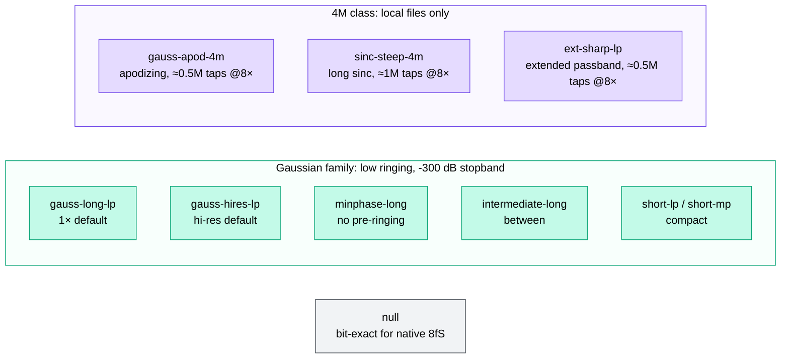
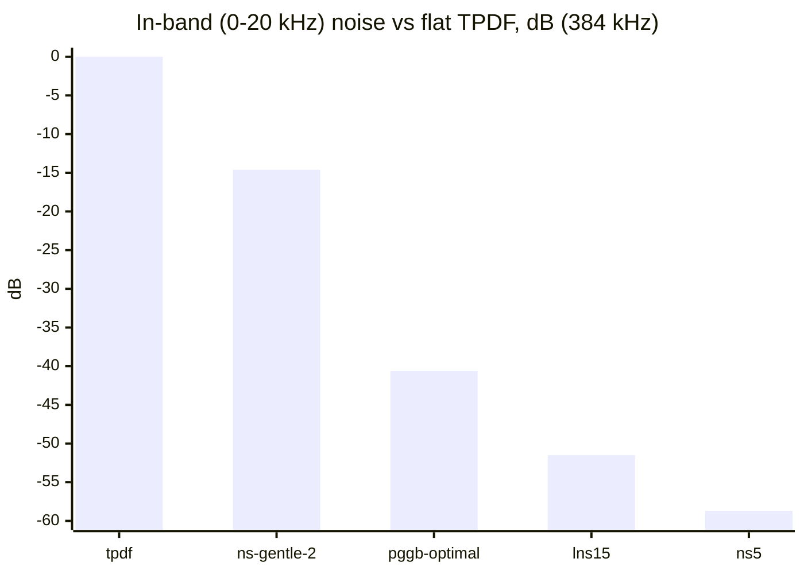
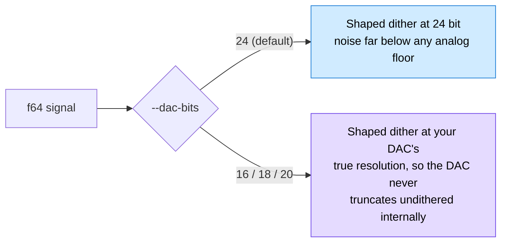
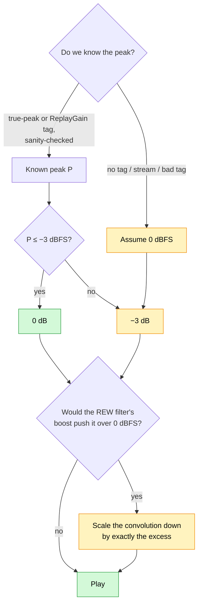
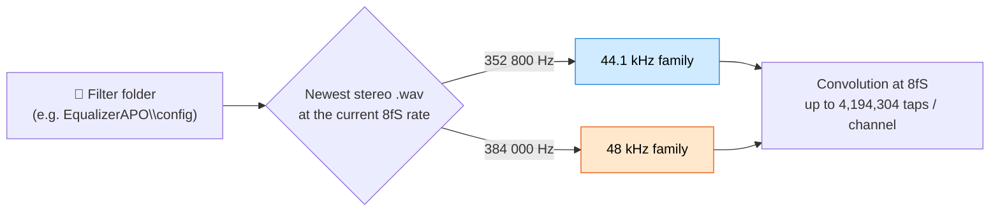
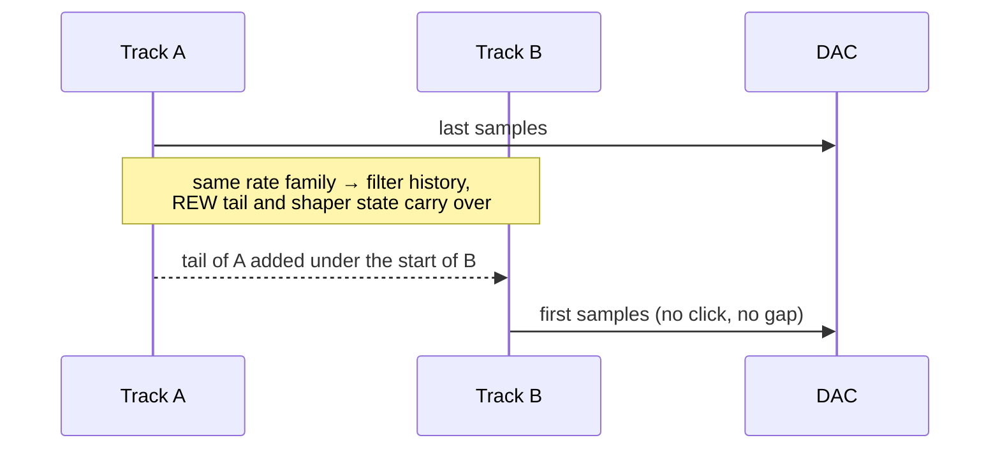

# 🎛️ Sound Engine

[← Home](../README.md) · [Ultimate Mode](ULTIMATE_MODE.md) · **Sound Engine** · [Getting Started](GETTING_STARTED.md)

This page assumes you already know the vocabulary: poly-sinc, apodizing, closed-form, NS5/LNS15, DAC bits. It covers what this player does differently, and why.

---

## Design choices at a glance

| Choice | Why |
|---|---|
| **8fS only** (352.8 kHz for the 44.1 kHz family, 384 kHz for the 48 kHz family) | Every filter, shaper and test is tuned for exactly two output rates, using integer ratios only (2×–8×) |
| **f64 from decoder to quantizer** | Rounding happens once, at the end, with dither |
| **≤ 4M taps** | No credible evidence of audible benefit beyond that, and it bounds memory |
| **No volume, no EQ, no effects** | Gain is used only to prevent clipping. Room correction is your REW filter, nothing else |
| **WDM-KS exclusive** | The Windows mixer is never in the path (and our opt-in Tidal virtual ACX driver blocks `audiodg.exe` in the kernel too). Pause **releases** the DAC |

---

## Upsampling filters

| Filter (`--filter`) | Family / character | Closest idea if you know HQPlayer | Typical use |
|---|---|---|---|
| `gauss-long-lp` | Linear-phase Gaussian. Flat to 20 kHz, −300 dB at source Nyquist | Gaussian / closed-form family | 1× default; jazz, acoustic, ambient |
| `gauss-hires-lp` | Same, flat to 0.42 × source rate | Hi-res Gaussian | 88.2–192 kHz default |
| `minphase-long` | Minimum-phase Gaussian (alias `gauss-hires-mp`) | `-mp` variants | Taste: all ringing after the transient |
| `intermediate-long` | Intermediate-phase Gaussian (alias `gauss-hires-ip`) | `-ip` / asymmetric variants | Taste: between linear and minimum |
| `gauss-apod-4m` | Ultra-steep **apodizing** Gaussian | Apodizing Gauss class | Masters with pre-ringing; loud & clipped masters |
| `sinc-steep-4m` | Very long Kaiser sinc | `sinc-L`-class long sinc | Classical; general 1× in Ultimate |
| `ext-sharp-lp` | Sharp, extended passband | Extended / "xtr"-style sharp | Rock, pop, electronic |
| `short-lp`, `short-mp` | Short Gaussian, −150 dB | Short filters | Low-power machines |
| `null` | Pass-through | — | Native 352.8 / 384 kHz sources |

The "closest idea" column is an analogy only. These are original designs, not copies of commercial filters.

### Which filter plays, in normal mode

`--filter <name>` forces one filter for every track (native 8fS still passes through). For the **per-recording** choice, see [Ultimate Mode](ULTIMATE_MODE.md#how-the-filter-is-chosen).

---

## Noise shaping and DAC bits

There is one quantizer, right at the end. It always applies TPDF dither, plus noise shaping designed for **8fS only**. Coefficient tables designed for 44.1 or 48 kHz are never reused at 8fS.

| Shaper (`--shaper`) | Order | In-band gain | Ultrasonic cost | Code activity* | When |
|---|---|---|---|---|---|
| `tpdf` | flat | 0 dB | none | 🟢 lowest | Outputs that aren't 8fS |
| `ns-gentle-2` | 2 | −14.6 dB | +6 dB peak | 🟢 low | **Default** at 8fS |
| `pggb-optimal` (`wide40-9`) | 9 | −40.6 dB, quiet to 40 kHz | +18 dB peak | 🟠 high | Listening option |
| `lns15` (`lns15-class`) | 15 | −51.5 dB | +15 dB peak | 🟠 high | Listening option |
| `ns5` (`ns5-class`) | 5 | −58.7 dB | +20 dB peak | 🔴 highest | Listening option |
| `bypass` | — | — | — | — | Automatic for native 32-bit 8fS with `null` (bit-perfect) |

\*Code activity is how far the output word jumps from sample to sample. On a NOS R-2R ladder, more activity means more major-carry glitches. That's why the default is the **gentlest shaper that already pushes noise below a high-end DAC's analog floor**, not the most aggressive one.

### DAC bits

Set `--dac-bits 16` only if you know your converter chips truncate to 16 bits (some R-2R designs do). At 16 bits, `ns-gentle-2` brings in-band noise from about −106 dBFS (flat TPDF) to about −121 dBFS. The output word is always 32-bit; only the dithered resolution changes.

---

## Headroom: never louder, just safe

- Gain is **never > 0 dB**. There is no loudness matching and no volume control.
- Peak tags are checked for realism before they're trusted. Implausible values count as unknown.
- REW filters are **not** normalized at load, so their boosts can fill the room's dips. Only the excess that would clip is removed.
- If something still clips, the quantizer saturates cleanly and reports how many samples were affected (`[clip warn]`).
- Ultimate mode replaces this with an **exact measured gain**. See [Exact headroom](ULTIMATE_MODE.md#exact-headroom-one-gain-whole-track).

---

## REW room correction

- Export **two** stereo IRs from REW, one at 352,800 Hz and one at 384,000 Hz. Each source family then uses the matching filter.
- Point the player at a folder (it picks the newest matching file) or at explicit files. See [Getting Started → Room correction](GETTING_STARTED.md#room-correction-rew).
- Mono `.L` / `.R` helper files, WAVs at the wrong rate and truncated WAVs are skipped, and the reason is logged. The EqualizerAPO `config.txt` file itself is not read.
- Ultimate mode uses the full IR tail. Normal mode trims IR tails below −200 dB on IRs longer than 64k taps.

---

## Gapless

Gapless works for local random and sequential playback, and for UPnP controllers that send the next track ahead of time. When the rate family changes (44.1 → 48), Track A's tail is played out completely before Track B starts.

[← Ultimate Mode](ULTIMATE_MODE.md) · Next: [🚀 Getting Started →](GETTING_STARTED.md)
