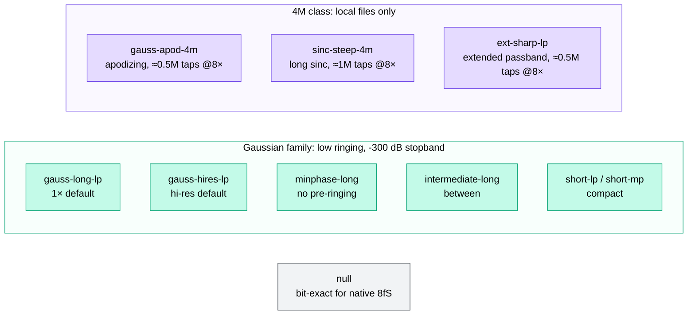
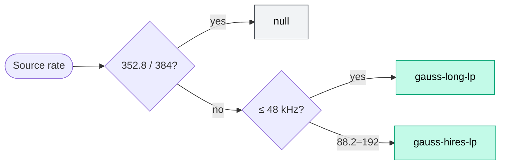
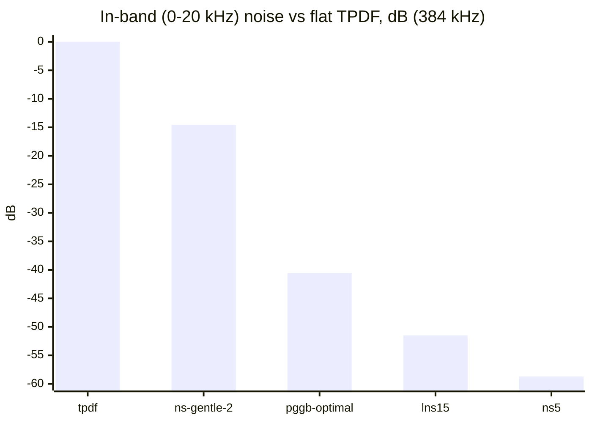
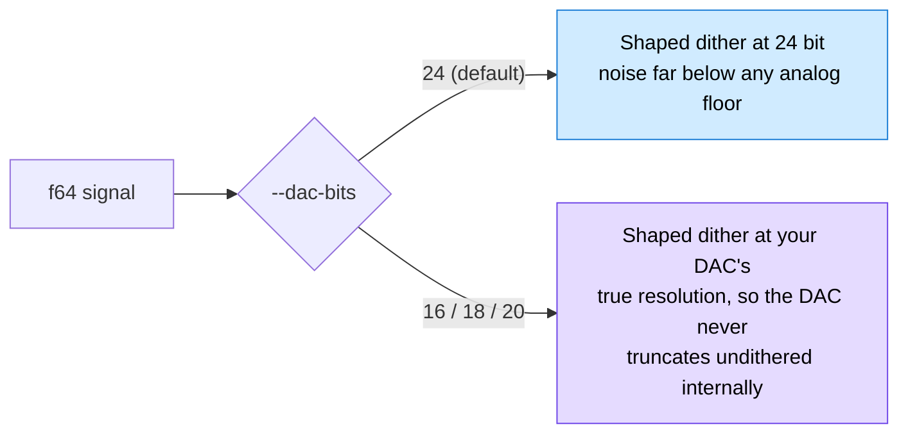
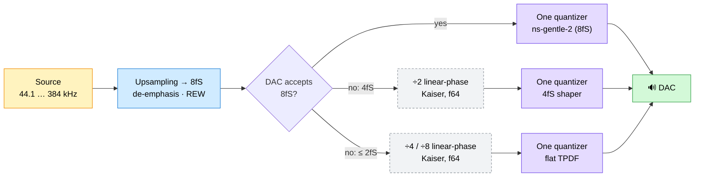
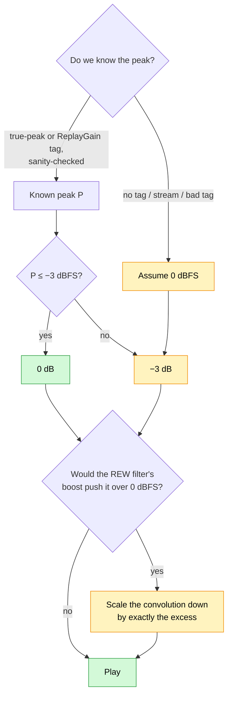
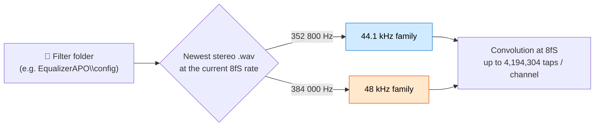
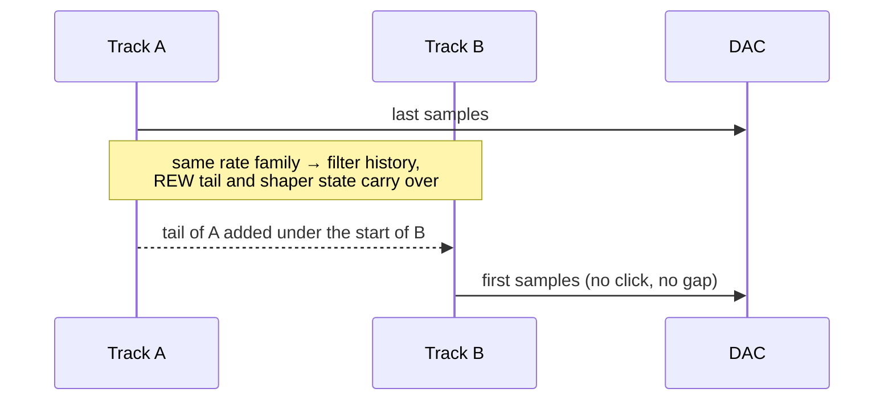

# 🎛️ Sound Engine

[🏠 Home](../README.md) · [🚀 Quick Start](QUICK_START.md) · [🧭 Getting Started](GETTING_STARTED.md) · [💎 Ultimate Mode](ULTIMATE_MODE.md) · **🎛️ Sound Engine** · [⌨️ CLI](CLI.md)

This page assumes you already know the vocabulary: poly-sinc, apodizing, closed-form, NS5/LNS15, DAC bits. It covers what this player does differently, and why.

---

## Design choices at a glance

| Choice | Why |
|---|---|
| **8fS main pipeline** (352.8 kHz for the 44.1 kHz family, 384 kHz for the 48 kHz family) | Upsampling, de-emphasis and REW convolution always run at 8fS, whatever the DAC. On a 352.8 / 384 kHz DAC the output is native 8fS. On a slower DAC, one pure-f64 downsampler runs at the very last stage, right before the single quantizer ([details](#lower-rate-dacs-below-8fs)) |
| **f64 from decoder to quantizer** | Rounding happens once, at the end, with dither |
| **≤ 4M taps** | No credible evidence of audible benefit beyond that, and it bounds memory |
| **No volume, no EQ, no effects** | Gain is used only to prevent clipping. Room correction is your REW filter, nothing else |
| **WDM-KS exclusive** | The Windows mixer is never in the path (and our opt-in Tidal virtual ACX driver blocks `audiodg.exe` in the kernel too). Pause **releases** the DAC |

---

## Upsampling filters

| Filter (`--filter`) | Family / character | Closest idea if you know HQPlayer | Typical use |
|---|---|---|---|
| `gauss-long-lp` | Linear-phase Gaussian. Flat to 20 kHz, −300 dB at source Nyquist | Gaussian / closed-form family | 1× default; jazz, acoustic, ambient |
| `gauss-hires-lp` | Same, flat to 0.42 × source rate | Hi-res Gaussian | 88.2–192 kHz default |
| `minphase-long` | Minimum-phase Gaussian (alias `gauss-hires-mp`) | `-mp` variants | Taste: all ringing after the transient |
| `intermediate-long` | Intermediate-phase Gaussian (alias `gauss-hires-ip`) | `-ip` / asymmetric variants | Taste: between linear and minimum |
| `gauss-apod-4m` | Ultra-steep **apodizing** Gaussian | Apodizing Gauss class | Masters with pre-ringing; loud & clipped masters |
| `sinc-steep-4m` | Very long Kaiser sinc | `sinc-L`-class long sinc | Classical; general 1× in Ultimate |
| `ext-sharp-lp` | Sharp, extended passband | Extended / "xtr"-style sharp | Rock, pop, electronic |
| `short-lp`, `short-mp` | Short Gaussian, −150 dB | Short filters | Low-power machines |
| `null` | Pass-through | — | Native 352.8 / 384 kHz sources |

The "closest idea" column is an analogy only. These are original designs, not copies of commercial filters. For a living collection of listener opinions and forum filter guides mapped to these filters, see [Community Filter Preferences](FILTER_PREFERENCES.md).

### Which filter plays, in normal mode

`--filter <name>` forces one filter for every track (native 8fS still passes through). For the **per-recording** choice, see [Ultimate Mode](ULTIMATE_MODE.md#how-the-filter-is-chosen).

---

## Noise shaping and DAC bits

There is one quantizer, right at the end. It always applies TPDF dither, plus noise shaping designed for the **actual output rate**: every shaper has its own frozen coefficient table for 8fS (352.8 / 384 kHz) and for 4fS (176.4 / 192 kHz). Tables designed for one rate are never reused at another. At 96 kHz and below there is too little ultrasonic room to park noise, so the output gets flat TPDF dither (forcing a shaper there prints a `[shaper warn]` and falls back to `tpdf`).

| Shaper (`--shaper`) | Order | In-band gain | Ultrasonic cost | Code activity* | When |
|---|---|---|---|---|---|
| `tpdf` | flat | 0 dB | none | 🟢 lowest | Outputs at 96 kHz and below |
| `ns-gentle-2` | 2 | −14.6 dB | +6 dB peak | 🟢 low | **Default** at 8fS and 4fS |
| `pggb-optimal` (`wide40-9`) | 9 | −40.6 dB, quiet to 40 kHz | +18 dB peak | 🟠 high | Listening option |
| `lns15` (`lns15-class`) | 15 | −51.5 dB | +15 dB peak | 🟠 high | Listening option |
| `ns5` (`ns5-class`) | 5 | −58.7 dB | +20 dB peak | 🔴 highest | Listening option |
| `bypass` | — | — | — | — | Automatic for native 32-bit 8fS with `null` (bit-perfect) |

The figures in the table are for 384 kHz. At 4fS each shaper uses its own table, designed for the narrower ultrasonic band, so these exact figures don't apply there.

\*Code activity is how far the output word jumps from sample to sample. On a NOS R-2R ladder, more activity means more major-carry glitches. That's why the default is the **gentlest shaper that already pushes noise below a high-end DAC's analog floor**, not the most aggressive one.

### DAC bits

Set `--dac-bits 16` only if you know your converter chips truncate to 16 bits (some R-2R designs do). At 16 bits, `ns-gentle-2` brings in-band noise from about −106 dBFS (flat TPDF) to about −121 dBFS at 8fS.

The output word is 32-bit whenever the DAC accepts it; only the dithered resolution changes. If the DAC only accepts a smaller container (see [wire formats](#wire-formats-32--24--16-bit-containers)), the dithered resolution is capped at what fits: a 16-bit-only DAC is always dithered at 16 bits.

---

## Lower-rate DACs (below 8fS)

A 352.8 / 384 kHz DAC is still the reference, but DACs that stop at 192, 176.4, 96, 88.2, 48 or 44.1 kHz are supported too. The rule: **the main chain never changes**. It runs at 8fS in f64 exactly as on a native 8fS DAC, and only the very last stage converts down.

| DAC's best rate (per family) | What the last stage does | Noise shaping |
|---|---|---|
| 352.8 / 384 kHz | Nothing. No downsampler in the path at all | 8fS shapers (`ns-gentle-2` default) |
| 176.4 / 192 kHz (4fS) | ÷2 | 4fS shapers (`ns-gentle-2` default; `ns5`, `lns15`, `pggb-optimal` available) |
| 88.2 / 96 kHz (2fS) | ÷4 | Flat TPDF |
| 44.1 / 48 kHz (1fS) | ÷8 | Flat TPDF |
| Only one clock family (e.g. a 48 / 96 / 192 kHz-only HDMI or S/PDIF device) | For the other family: exact rational (L/M) polyphase conversion, e.g. 352.8 → 192 kHz | As per the output rate |

- **The downsampler** is a linear-phase, odd-length Kaiser-windowed sinc designed in extended precision: passband flat to ±0.01 dB, aliasing ≤ −190 dB. It runs in f64 and nothing is quantized before it, so the DAC still sees exactly one rounding step.
- **Same family first.** The player always prefers the highest rate in the source's own clock family (44.1 kHz material → 176.4, not 192). It crosses families only when the DAC accepts nothing from that family.
- **Gapless is preserved.** The downsampler's state carries over between tracks just like the filter, REW and shaper state.
- **Probing is automatic.** At start-up the player asks the DAC which rates and containers it accepts and picks the best per family. `audiophile-player devices` shows the same probe, and `doctor` reports it under `dac`.
- **`--max-rate HZ`** (or `max_rate` in `[player]`) caps the output by hand, for example `--max-rate 96000` on a 384 kHz DAC to compare, or to work around a DAC that misbehaves at its top rate. Allowed values: `auto`, 44100, 48000, 88200, 96000, 176400, 192000, 352800, 384000. The main chain stays at 8fS either way.

### Wire formats: 32 / 24 / 16-bit containers

The player prefers 32-bit integer samples on the wire. If the DAC doesn't accept them it falls back, in this order: 24-in-32, packed 24-bit, then 16-bit. The quantizer's `--dac-bits` is capped at what the container can carry (a 16-bit container means 16-bit dither), so nothing is ever truncated after dithering.

---

## Headroom: never louder, just safe

- Gain is **never > 0 dB**. There is no loudness matching and no volume control.
- Peak tags are checked for realism before they're trusted. Implausible values count as unknown.
- REW filters are **not** normalized at load, so their boosts can fill the room's dips. Only the excess that would clip is removed.
- If something still clips, the quantizer saturates cleanly and reports how many samples were affected (`[clip warn]`).
- Ultimate mode replaces this with an **exact measured gain**. See [Exact headroom](ULTIMATE_MODE.md#exact-headroom-one-gain-whole-track).

---

## REW room correction

- Export **two** stereo IRs from REW, one at 352,800 Hz and one at 384,000 Hz. Each source family then uses the matching filter.
- Point the player at a folder (it picks the newest matching file) or at explicit files. See [Getting Started → Room correction](GETTING_STARTED.md#room-correction-rew).
- Mono `.L` / `.R` helper files, WAVs at the wrong rate and truncated WAVs are skipped, and the reason is logged. The EqualizerAPO `config.txt` file itself is not read.
- Ultimate mode uses the full IR tail. Normal mode trims IR tails below −200 dB on IRs longer than 64k taps.

---

## Gapless

Gapless works for local random and sequential playback, and for UPnP controllers that send the next track ahead of time. When the rate family changes (44.1 → 48), Track A's tail is played out completely before Track B starts.

[← Ultimate Mode](ULTIMATE_MODE.md) · [🏠 Home](../README.md) · Next: [⌨️ CLI Reference →](CLI.md)
