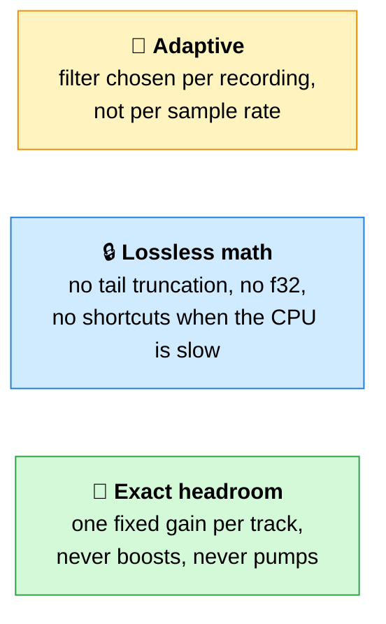
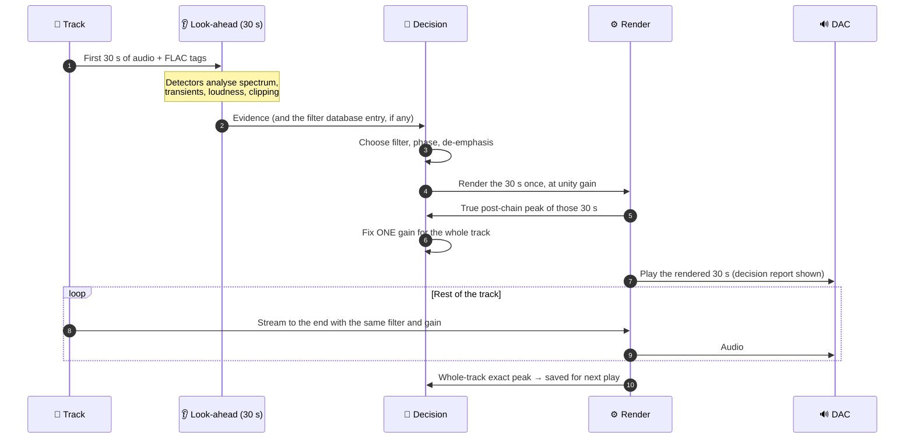
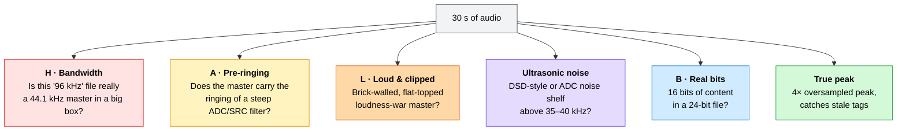
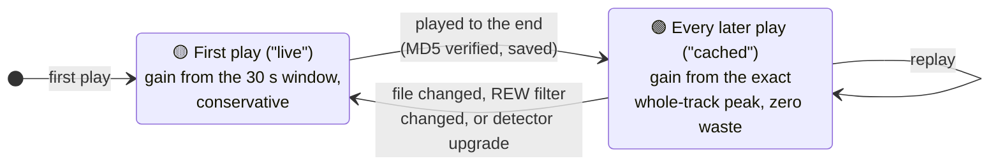

# 💎 Ultimate Mode

[🏠 Home](../README.md) · [🚀 Quick Start](QUICK_START.md) · [🧭 Getting Started](GETTING_STARTED.md) · **💎 Ultimate Mode** · [🎛️ Sound Engine](SOUND_ENGINE.md) · [⌨️ CLI](CLI.md)

> **One idea:** before a track plays, *listen to it*. Ultimate mode takes the first 30 seconds of the recording, the FLAC tags, and anything it learned the last time it played the track. From those it chooses the filter, the de-emphasis and the gain that suit **this particular master**. Nothing in the chain is approximated to save CPU.

Turn it on for one session with `--ultimate`, or permanently with `audiophile-player config set ultimate.enabled true` (that's `enabled = true` under `[ultimate]` in the config file) followed by `audiophile-player restart`. With an AI agent connected over MCP, just say *"turn on ultimate mode"* ([how](QUICK_START.md#controlling-the-player-through-mcp)).

It works the same on every DAC. All analysis, filter choice and rendering happen in the 8fS chain; on a DAC below 352.8 / 384 kHz the [last-stage downsampler](SOUND_ENGINE.md#lower-rate-dacs-below-8fs) is applied afterwards.

---

## The three promises



"Slow is allowed, lossy is not." If your PC can't render a heavy filter fast enough, Ultimate mode switches to a **lighter filter that is still mathematically exact**. It never cuts corners on the filter it picked.

---

## What happens when you press Play



The 30-second cap is deliberate. Streams and gapless playlists can't wait longer than that, and if a look-ahead runs past the end of the track, the analysis is wasted on the next one. Within 30 seconds of a track boundary, the music is assumed to be one consistent recording.

> ⏱️ **Start-up delay:** the first 30 seconds are fully rendered before the first sample plays. With the 4M-class filters on a modest PC, this takes noticeably longer than in normal mode. That cost buys the quality.

**Tracks shorter than 30 s** (interludes, hidden tracks) are played with normal-mode defaults and labelled `normal (<30 s)` in the report.

---

## The detectors: what it listens for



| Detector | What it actually looks for | What it changes |
|---|---|---|
| 🔴 **H, fake hi-res** | A spectral cliff at about 20 kHz with real music below it and nothing above 25 kHz. More sensitive when `ORIGINALSAMPLERATE` says the source was lower | The track is treated as 1× material: its real Nyquist is 22.05 / 24 kHz |
| 🟡 **A, apodizing need** | Pre-ringing events near Nyquist just before transients. More sensitive for 1982–1995 early-digital masters | Selects the **apodizing** filter, which replaces the master's pre-ringing with its own gentle roll-off |
| 🟠 **L, loud & clipped** | BS.1770 loudness ≥ −10 LUFS **and** repeated clipped runs | Also selects the apodizing filter, which is the gentlest on flat-topped transients |
| 🟣 **Ultrasonic noise** | A rising noise shelf above 35–40 kHz (DSD-derived or noisy ADC) | Reported, and an HF-noise-aware hi-res path is used |
| 🔵 **B, effective bits** | Lowest bit actually used across the samples | Report only (for example "16-bit content in 24-bit container") |
| 🟢 **True peak** | 4× oversampled peak of the window | Rejects ReplayGain peak tags that are provably wrong |

Lossy-origin suspicion (a cliff around 16 kHz) and MQA are only **reported**. They never change the sound on their own.

---

## Who gets the final word

Not every piece of evidence is equally trustworthy. Ultimate mode ranks it:


Stronger evidence (left) beats weaker evidence (right). Tags are never trusted blindly: a ReplayGain peak that the music itself exceeds is discarded on the spot. A genre or year tag alone can never trigger the apodizing filter. It can only make the detector more sensitive.

---

## How the filter is chosen


- "Your choice" means `--filter` on the command line, an entry in `my-filters.yaml`, or an `AP_FILTER` tag. The last two are used in `mine` mode (the default whenever `my-filters.yaml` exists); `--filters suggested` skips them for an A/B comparison. See [Your overrides](#your-overrides-my-filtersyaml).
- An `AP_PHASE` tag (or `phase:` in `my-filters.yaml`) with `minimum` / `intermediate` / `linear` switches to the **min-phase** or **intermediate-phase** member of the Gaussian family.
- The genre rules are on by default. Turn them off with `--no-genre-rules` or `genre_rules = false` in `[ultimate]`.
- On **streams** (UPnP and live exclusive Tidal capture), the 4M-class filters are replaced by their long Gaussian equivalents (`gauss-long-lp` / `gauss-hires-lp`). Live real-time capture starts with a short ~0.75 s cushion instead of waiting 30 s, while still keeping Ultimate mode's full-tail REW convolution and pure-`f64` 8fS path.

The filters themselves are described in [Sound Engine → Filters](SOUND_ENGINE.md#upsampling-filters).

---

## Exact headroom: one gain, whole track

Normal mode reserves −3 dB whenever the peak is unknown, to be safe. Ultimate mode **measures** the peak after the complete chain (filter, REW, quantizer margin) and sets one fixed gain for the whole track. That gain is ≤ 0 dB, never a boost, and it never changes mid-track.



- If you skip mid-track, nothing is saved. A file whose audio MD5 doesn't match its header is never saved either.
- Running an **offline scan** (`scan --post-chain`) pre-measures your whole library, so even the first play is `cached`. See [Getting Started → Scan](GETTING_STARTED.md#scan-your-library-optional).
- Streams (UPnP and live exclusive Tidal capture) always keep −3 dB, because their peak and end are unknown ahead of time.

---

## Pre-emphasis

Early-1980s CDs with pre-emphasis get exact IEC **50/15 µs de-emphasis** in f64, applied before room correction. It is applied only when there is a **fact** to go on:
- the CUESHEET pre-emphasis flag,
- an `AP_DEEMPHASIS` tag,
- or a `deemphasis: true` entry in your `my-filters.yaml`.

A "sounds bright, 1982–1989" guess is only logged as a suggestion. It is never applied automatically.

---

## Your overrides (my-filters.yaml)

Ultimate mode cleanly separates **machine-managed analysis** from **your personal filter choices** (Schema 2):

- **Machine-managed analysis (`%APPDATA%\audiophile-player\filterdb\`):** one human-readable YAML file per album folder mirroring your library tree (e.g. `filterdb\analysis\main\Jazz\Kind of Blue.yaml`). Every track records `suggested`, a plain-English `why`, detector readings, and exact `post_chain_peaks`. Your music library stays 100% read-only.
- **Your choices (`%APPDATA%\audiophile-player\my-filters.yaml`):** a single file owned exclusively by you — never silently overwritten by the player or scanner, hot-reloaded on track change, with support for defaults, folder/artist rules, and per-track overrides:

```yaml
schema: 2

defaults:
  # optional fallback override

folders:
  "main:Jazz/Miles Davis - Kind of Blue":
    filter: gauss-long-lp
    note: "prefer gauss-long-lp on this pressing"

tracks:
  "main:Classical/Mahler/01_Adagio.flac":
    filter: sinc-steep-4m
    deemphasis: false
    note: "Japanese pressing, sounds better steep"
```

### Precedence & A/B mode (`--filters`)

- **Default (`--filters auto`):** uses `mine` mode whenever `my-filters.yaml` exists, falling back to `suggested`.
- **A/B comparison (`--filters suggested`):** ignores `my-filters.yaml` and `AP_*` overrides and plays pure machine suggestions without editing any files.
- **Precedence in `mine` mode:** CLI `--filter` → `my-filters.yaml` `tracks:` → deepest `folders:` → shallower `folders:` → FLAC Vorbis tags (`AP_FILTER`, `AP_PHASE`, `AP_DEEMPHASIS`, `AP_APODIZING`) → `my-filters.yaml` `defaults:` → machine `suggested` analysis.
- Explicit choices in `my-filters.yaml` also apply to short tracks (`< 30 s`), while automatic detectors remain strictly per-track.
- Whenever a user choice overrides the machine suggestion, both the console and the HTTP UI display them side by side:
  `playing: gauss-long-lp (mine: folder) | suggested: sinc-steep-4m (rule_G_classical)`.

You rarely need to edit the file by hand. The `filters` commands validate the filter name, keep your comments and save a `.bak` first:

```powershell
audiophile-player filters set "D:\Music\Jazz\Miles Davis - Kind of Blue" gauss-long-lp --note "prefer gauss-long-lp on this pressing"
audiophile-player filters set "D:\Music\Classical\Mahler\01_Adagio.flac" sinc-steep-4m
audiophile-player filters set "D:\Music" gauss-long-lp     # a default for the whole library root
audiophile-player filters show "D:\Music\Jazz\Miles Davis - Kind of Blue"   # mine vs suggested, and why
audiophile-player filters diff                               # every place you disagree with the machine
audiophile-player filters check                              # catch typos and dead paths
```

Changes apply from the **next track**, with no restart. With an AI agent, *"use apodizing for this album"* does the same through the `filters_set` tool. The full command list is in [Getting Started → Filter database](GETTING_STARTED.md#filter-database).

Upgrading from an older version? `audiophile-player filters migrate` imports your Schema-1 `trackdb\` entries and `user:` overrides into Schema 2 without deleting anything.

---

## Reading the decision report

Every track prints one line to the console and to the web page. The example below is illustrative:

```text
ultimate=[mode=[ultimate: cached] rule=rule_A_apodizing fired=[A(apod:cache(WT)),G(Classical)]
          M=-0.85dBFS(cached) G=-0.912dB m_q=0.00027dB speed=3.4xRT]
```

| Field | Meaning |
|---|---|
| `mode` | 🟢 `cached` = exact memory · 🟡 `live` = first play · ⚪ `normal (<30 s)` |
| `rule` | Which rule picked the filter: `user_filter`, `user_phase_min` / `user_phase_ip`, `rule_A_apodizing`, `rule_L_loud_clipped`, `rule_G_classical` (etc.), `rule_H_fake_hires`, `rule_R_1x_clean`, `rule_R_hires_clean`, `throughput_fallback(…)`, `cli_override`, `short_track_bypass` |
| `fired` | Every rule that said "yes", and where its evidence came from (`user`, `cache(WT)`, `header`, `window(W30)`, `tag`) |
| `M` / `M30` | Whole-track / 30-second peak after the full chain |
| `G` | The fixed gain applied to the whole track |
| `speed` | Render speed in multiples of real time. Below the required speed, a lighter **exact** filter is used |

[← Getting Started](GETTING_STARTED.md) · [🏠 Home](../README.md) · Next: [🎛️ Sound Engine →](SOUND_ENGINE.md)
